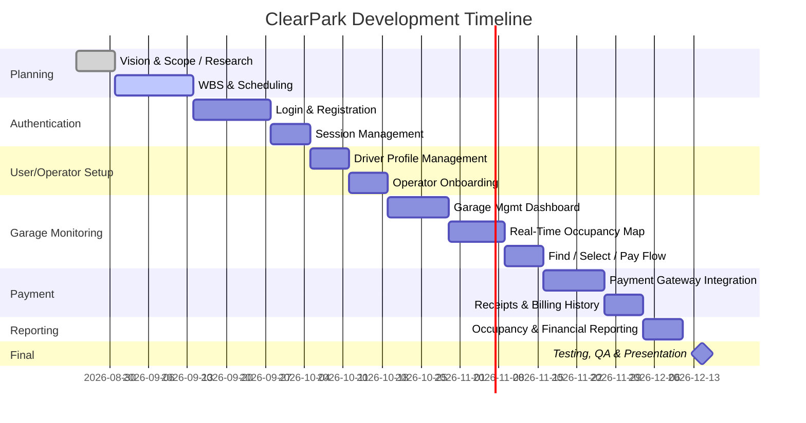

# ClearPark: Smart Parking Platform
### Project Document — WE ARE $oftware ¢orp.

**Course:** CIS 4374 — University of Houston
**Document Type:** Vision & Scope / Software Requirements Specification (Living Document)

---

## Version History

| Version | Date | Author | Summary of Changes |
|---------|------|--------|---------------------|
| 0.1 | Week 1 | David Thai | Initial draft: Research, Vision & Scope, and SRS draft (15+ use cases) created |
| 0.2 | Week 2 (Sept 17, 2026) | David Thai | Added Work Breakdown Structure (3+ levels) and draft project timeline with Gantt chart |
| 0.3 | Week 3 | David Thai | Added product backlog and Sprint 1 plan (Trello board + screenshot) |
| 0.4 | Week 4 | David Thai | Added risk identification (4+ per category), risk register (17 entries), and communication plan |
| 0.5 | Week 5 | David Thai | Added roles & resources, bottom-up cost plan with monthly cashflow, and RACI matrix |

*(Update this table every week per course instructions — bump the version number and note what changed.)*

---

## Table of Contents

1. [Research: Competitive Analysis](#1-research-competitive-analysis)
2. [Vision and Scope](#2-vision-and-scope)
3. [Software Requirements Specification (Draft)](#3-software-requirements-specification-draft)
   - 3.1 [Use Case Diagram Overview](#31-use-case-overview)
   - 3.2 [Use Cases](#32-use-cases)
4. [Work Breakdown Structure (WBS)](#4-work-breakdown-structure-wbs)
5. [Project Timeline & Gantt Chart](#5-project-timeline--gantt-chart)
6. [Product Backlog & Sprint 1 Plan](#6-product-backlog--sprint-1-plan)
7. [Risk Management](#7-risk-management)
8. [Communication Plan](#8-communication-plan)
9. [Roles & Resources](#9-roles--resources)
10. [Resource & Cost Plan](#10-resource--cost-plan)
11. [RACI Matrix](#11-raci-matrix)
12. [References](#12-references)

---

## 1. Research: Competitive Analysis

### 1.1 Purpose

Before defining ClearPark's scope, WE ARE $oftware ¢orp. conducted a review of existing smart-parking products to understand the current market landscape, identify gaps, and determine how ClearPark will differentiate itself.

### 1.2 Existing Software Landscape

| Product | Focus | Strengths | Weaknesses |
|---|---|---|---|
| **ParkMobile** | On-street/metered parking, city partnerships | Largest zone coverage in the U.S. (500+ cities); deep integration with municipal parking systems and DOTs | Per-transaction convenience fees; limited focus on off-street garage reservations; GPS-based session tracking can fail to detect when a driver has left, leading to overcharges |
| **SpotHero** | Pre-booked garage/lot/event parking | Strong brand recognition ("#1 Rated Parking App"); partnerships (e.g., Apple Maps integration for 8,000+ locations); good filtering (EV charging, accessibility, valet) | Limited in smaller/secondary cities; pricing can surge between search and checkout, frustrating users |
| **ParkWhiz** | Garage reservations for events, airports, downtown | Deep discounts (up to 50%) for pre-booked spots; easy booking UX | Coverage concentrated in major metro/event markets; less useful for everyday commuter parking |
| **PayByPhone** | Metered/on-street payment, expanding internationally | Official partner in many cities; straightforward pay-by-phone metering | Convenience fees vary by city; minimal reservation or analytics features for operators |
| **Passport** | Municipal & university parking/transit management | Popular with smaller cities and university campuses; consolidates multiple permit/pass types in one app | Less brand recognition in large metros; feature depth varies city to city |
| **SpotAngels** | Community-driven free/street parking finder | Crowdsourced data helps avoid tickets and street-cleaning zones; free to use | No reservation or payment capability; relies on community data accuracy |

### 1.3 Common Pain Points Across Existing Solutions

- **Fragmentation** — drivers often need multiple apps depending on the city or lot (metered vs. garage vs. municipal).
- **Pricing transparency** — several platforms are criticized for prices shown in search differing from checkout totals once fees/surge pricing apply.
- **Session accuracy** — GPS-based auto-detection of arrival/departure is unreliable, causing billing disputes.
- **Operator-side tools** — most consumer-facing apps offer little for the parking facility operator (occupancy analytics, dynamic pricing controls, reporting).

### 1.4 Opportunity for Differentiation

ClearPark will differentiate itself by:

1. **Unifying** on-street, garage, and lot parking into a single real-time map/reservation experience (rather than specializing in only one, like most competitors).
2. Providing a genuine **operator-facing administrative dashboard** with occupancy analytics and pricing tools — a gap in most driver-first competitor apps.
3. Guaranteeing **transparent, locked-in pricing** at time of reservation to directly address the surge-pricing complaint common in competitor reviews.
4. Offering **built-in navigation hand-off** to external mapping/navigation services rather than requiring a separate app.

---

## 2. Vision and Scope

### 2.1 About WE ARE $oftware ¢orp.

WE ARE $oftware ¢orp. is a fictitious software development studio operating with a theoretically unlimited budget and staffed with dedicated teams across mobile, web, backend, mapping, payments, and QA. The studio was approached by a coalition of city transportation departments and independent parking garage operators who share a common problem: drivers can't find real-time parking availability, and operators lack modern digital tools to manage occupancy and pricing.

### 2.2 How This Project Was Acquired

City transportation departments and parking facility operators identified worsening downtown congestion linked directly to drivers circling in search of parking. An RFP (Request for Proposal) was issued for a unified platform that would serve both drivers and parking operators. WE ARE $oftware ¢orp. was selected to design, build, and deliver this platform over the course of the engagement, branded internally as **ClearPark**.

### 2.3 Project Overview

ClearPark is a web and mobile platform that allows drivers to locate, reserve, and pay for parking in real time, while giving parking operators the tools to manage occupancy, pricing, and reporting. The platform addresses a clear business need: drivers lose time and money circling for parking, and operators lack visibility into utilization of their own assets.

### 2.4 Vision Statement

> For drivers who waste time and money searching for parking, and for operators who lack visibility into their facilities, ClearPark is a unified parking platform that provides real-time availability, reservations, and payment in one place — unlike fragmented single-purpose competitor apps, ClearPark serves both sides of the market with transparent pricing and operator-grade analytics.

### 2.5 Project Scope

**In Scope (Semester Deliverable):**
- User registration/authentication
- Real-time parking availability + interactive map
- Reservation and digital payment processing
- Reservation history/receipts
- Notifications/alerts
- Administrative dashboard (occupancy reporting, analytics)
- Integration with third-party mapping/navigation APIs
- Integration with third-party payment providers

**Out of Scope (for now — may be revisited):**
- Autonomous vehicle valet/parking assist
- Physical hardware (sensors, gate systems) — assumed to be provided by facility operators or a future phase
- Dynamic city-wide traffic rerouting

### 2.6 Stakeholders

| Stakeholder | Interest |
|---|---|
| Drivers / vehicle owners | Fast, reliable way to find and pay for parking |
| Parking facility operators | Tools to manage occupancy, pricing, and reporting |
| City transportation departments | Reduced congestion, data on parking utilization |
| System administrators | Platform uptime, security, user management |
| Finance and billing personnel | Accurate transaction processing and reconciliation |
| Mobile application users | Seamless mobile experience |
| Third-party payment providers | Reliable integration and transaction volume |

### 2.7 Constraints

- Unlimited theoretical development budget, but a **fixed semester timeline**
- Dependence on third-party mapping and payment APIs
- Must comply with security/privacy regulations and city ordinances

---

## 3. Software Requirements Specification (Draft)

*This section is a living draft. It will grow week over week as requirements are elicited and refined, per the course's weekly document-update requirement.*

### 3.1 Use Case Overview

The initial use case set below covers the core driver-facing, operator-facing, and system-level interactions identified from the high-level requirements. Additional use cases will be added as stakeholder analysis continues.

**Actors:** Driver, Parking Operator, System Administrator, Payment Gateway (external), Mapping Service (external), System (automated).

### 3.2 Use Cases

| ID | Use Case Name | Primary Actor | Description |
|----|----|----|----|
| UC-01 | Register Account | Driver | Driver creates a new account with email/phone and profile details. |
| UC-02 | Log In | Driver | Registered driver authenticates to access the platform. |
| UC-03 | Search for Parking | Driver | Driver searches for parking near a destination via map or address. |
| UC-04 | View Real-Time Availability | Driver | Driver views live occupancy/availability for nearby facilities on an interactive map. |
| UC-05 | Reserve Parking Space | Driver | Driver selects a facility, time window, and confirms a reservation. |
| UC-06 | Cancel Reservation | Driver | Driver cancels an existing reservation prior to arrival. |
| UC-07 | Process Payment | Driver | Driver pays for a reservation or on-demand session digitally. |
| UC-08 | View Reservation History & Receipts | Driver | Driver reviews past reservations and downloads receipts. |
| UC-09 | Receive Notifications/Alerts | Driver | System sends alerts (e.g., reservation confirmation, expiration warning). |
| UC-10 | Navigate to Facility | Driver | Driver receives turn-by-turn navigation via integrated mapping service. |
| UC-11 | Rate/Review Parking Facility | Driver | Driver submits a rating/review after a completed session. |
| UC-12 | Manage Facility Inventory | Parking Operator | Operator adds/edits parking facilities, spaces, and hours of operation. |
| UC-13 | Set/Adjust Pricing | Parking Operator | Operator configures pricing rules (hourly, daily, dynamic) for a facility. |
| UC-14 | View Occupancy Reports & Analytics | Parking Operator | Operator views dashboards showing utilization trends and revenue. |
| UC-15 | Manage User Accounts | System Administrator | Admin manages driver/operator accounts, roles, and access. |
| UC-16 | Monitor System Health | System Administrator | Admin monitors uptime, error logs, and third-party API integration status. |
| UC-17 | Send Expiration Reminder | System | System automatically notifies a driver before a reservation/session expires. |
| UC-18 | Authorize Payment via Gateway | Payment Gateway | External payment provider authorizes and settles a transaction initiated by the platform. |

*(18 use cases identified — exceeds the 15-use-case minimum for this milestone. Each will be expanded into full flow-of-events detail as the SRS matures.)*

#### 3.2.1 Sample Expanded Use Case — UC-05: Reserve Parking Space

| Field | Detail |
|---|---|
| **ID / Name** | UC-05 — Reserve Parking Space |
| **Primary Actor** | Driver |
| **Preconditions** | Driver is logged in; at least one facility has available space matching the driver's search |
| **Trigger** | Driver selects a facility and time window from search results |
| **Main Flow** | 1. Driver selects a facility from the map/list. 2. System displays available time slots and price. 3. Driver selects a time window and confirms. 4. System requests payment authorization (see UC-07). 5. System confirms the reservation and sends a notification (UC-09). |
| **Alternate Flow** | If the selected slot becomes unavailable before confirmation, system notifies the driver and prompts them to select another slot. |
| **Postconditions** | A confirmed reservation exists; the space is held for the driver for the reserved window. |

---

## 4. Work Breakdown Structure (WBS)

The WBS below decomposes ClearPark into its five major components — Authentication, User/Operator Setup, Garage Monitoring (Dashboards), Payment, and Reporting — broken down at least three levels deep, per this week's assignment.

### 4.1 Authentication

- **1.0 Authentication**
  - 1.1 Login
    - 1.1.1 Design login UI
    - 1.1.2 Implement email/password authentication
    - 1.1.3 Implement "forgot password" flow
  - 1.2 Registration
    - 1.2.1 Design registration form
    - 1.2.2 Implement driver registration
    - 1.2.3 Implement operator registration
  - 1.3 Session Management
    - 1.3.1 Implement session token generation
    - 1.3.2 Implement token refresh / auto-logout on expiration

### 4.2 User / Operator Setup

- **2.0 User / Operator Setup**
  - 2.1 Driver Profile Management
    - 2.1.1 Create/edit profile
    - 2.1.2 Manage saved vehicle information
  - 2.2 Operator Account Setup
    - 2.2.1 Operator onboarding workflow
    - 2.2.2 Role & permission assignment
  - 2.3 Account Administration
    - 2.3.1 Admin tools to view/edit/deactivate accounts

### 4.3 Garage Monitoring (Dashboards)

- **3.0 Garage Monitoring / Dashboards**
  - 3.1 Garage Management (Add / Edit / Remove Garage)
    - 3.1.1 Add new garage facility (location, capacity, pricing)
    - 3.1.2 Edit garage details
    - 3.1.3 Deactivate/remove a garage
  - 3.2 Real-Time Occupancy Monitoring
    - 3.2.1 Integrate occupancy data feed/sensor API
    - 3.2.2 Build live occupancy map view
  - 3.3 Find Parking, Select, and Pay
    - 3.3.1 Build search/filter interface
    - 3.3.2 Build reservation selection flow
    - 3.3.3 Hand off to Payment checkout (see 4.0)

### 4.4 Payment

- **4.0 Payment**
  - 4.1 Payment Gateway Integration
    - 4.1.1 Select third-party payment provider
    - 4.1.2 Implement provider API integration
  - 4.2 Transaction Processing
    - 4.2.1 Process reservation/on-demand payments
    - 4.2.2 Handle refunds and cancellations
  - 4.3 Receipts & Billing History
    - 4.3.1 Generate digital receipts
    - 4.3.2 Build reservation/payment history view

### 4.5 Reporting

- **5.0 Reporting**
  - 5.1 Occupancy Reporting
    - 5.1.1 Build occupancy graphs/charts
    - 5.1.2 Historical trend analysis
  - 5.2 Financial Reporting
    - 5.2.1 Build revenue reports
    - 5.2.2 Export financial reports (CSV/PDF)
  - 5.3 Notifications & Alerts
    - 5.3.1 Reservation/expiration alerts to drivers
    - 5.3.2 Low-occupancy/anomaly alerts to operators

---

## 5. Project Timeline & Gantt Chart

### 5.1 Draft Timeline (Table View)

| Phase | Task | Start | Duration | End |
|---|---|---|---|---|
| Planning | Vision & Scope / Research | Aug 24, 2026 | 1 week | Aug 30, 2026 |
| Planning | WBS & Scheduling (this week) | Aug 31, 2026 | 2 weeks | Sept 13, 2026 |
| Authentication | Login & Registration | Sept 14, 2026 | 2 weeks | Sept 27, 2026 |
| Authentication | Session Management | Sept 28, 2026 | 1 week | Oct 4, 2026 |
| User/Operator Setup | Driver Profile Management | Oct 5, 2026 | 1 week | Oct 11, 2026 |
| User/Operator Setup | Operator Onboarding | Oct 12, 2026 | 1 week | Oct 18, 2026 |
| Garage Monitoring | Garage Mgmt Dashboard (add/edit/remove) | Oct 19, 2026 | 1.5 weeks | Oct 29, 2026 |
| Garage Monitoring | Real-Time Occupancy Map | Oct 30, 2026 | 1.5 weeks | Nov 8, 2026 |
| Garage Monitoring | Find/Select/Pay Flow | Nov 9, 2026 | 1 week | Nov 15, 2026 |
| Payment | Payment Gateway Integration | Nov 16, 2026 | 1.5 weeks | Nov 26, 2026 |
| Payment | Receipts & Billing History | Nov 27, 2026 | 1 week | Dec 3, 2026 |
| Reporting | Occupancy & Financial Reporting | Dec 4, 2026 | 1 week | Dec 10, 2026 |
| Final | Testing, QA & Final Presentation | Dec 11, 2026 | 1 week | Dec 17, 2026 |

*(Dates are draft estimates for planning purposes and will be refined as the semester progresses and actual velocity is known.)*

### 5.2 Gantt Chart

*(This chart renders automatically on GitHub. If submitting as a Word document instead, use the table in Section 5.1 or paste a screenshot of this chart rendered from a tool like Mermaid Live Editor, Excel, or MS Project.)*

---

## 6. Product Backlog & Sprint 1 Plan

### 6.1 Tool Used

The product backlog was created and managed in **Trello**, organized as a board named "ClearPark Backlog" with lists mirroring the four required categories, plus a dedicated Sprint 1 list.

### 6.2 Backlog Summary

| List | Item Count | Minimum Required | Status |
|---|---|---|---|
| Login | 6 | 5 | ✅ Met |
| UI (Operator & User) | 16 | 15 | ✅ Met |
| Backend Processes | 16 | 15 | ✅ Met |
| Reporting | 11 | 10 | ✅ Met |
| **Sprint 1** | 14 | — | Planned |

### 6.3 Sprint 1 Backlog

Sprint 1 focuses on the core MVP loop — account access through a basic search-and-reserve flow — pulled from the Login and core driver-facing UI/backend items:

- Register with email/password
- Log in with credentials
- Reset forgotten password
- Operator login role for admin dashboard access
- Auto-expiring sessions for security
- Map view showing nearby parking availability
- Garage detail screen before reserving
- Reservation confirmation screen
- Payment/checkout screen
- Process registration and store profile

### 6.4 Board Screenshot

*Figure 1: ClearPark Backlog board in Trello, showing the Login, UI (Operator & User), Backend Processes, Reporting, and Sprint 1 lists.*

---

## 7. Risk Management

### 7.1 Identified Risks by Category

Risks were identified from the project brief (third-party dependencies, real-time data, payments, privacy and city ordinances, fixed semester timeline) and from the plans built in earlier weeks. Each category has at least four risks.

**Technical risks**

- **T-01:** Mapping/navigation API failure
- **T-02:** Inaccurate real-time occupancy data
- **T-03:** Payment integration failure or PCI non-compliance
- **T-04:** Security breach or privacy violation
- **T-05:** Poor performance under peak load

**Schedule risks**

- **S-01:** Scope creep on a fixed timeline
- **S-02:** Third-party onboarding delays
- **S-03:** Late integration problems
- **S-04:** Testing squeezed at the end

**Financial risks**

- **F-01:** Effort underestimated
- **F-02:** Usage-based fees exceed forecast
- **F-03:** Unplanned security remediation cost
- **F-04:** Vendor price or licence changes

**People risks**

- **P-01:** Loss of a key team member
- **P-02:** Skill gaps and learning curve
- **P-03:** Overallocation and burnout
- **P-04:** Slow or conflicting stakeholder decisions

### 7.2 Scoring Method

Each risk is scored on **Probability (P)** and **Impact (I)**, each from 1 to 5. **Score = P x I.**

| Scale | Probability | Impact |
|---|---|---|
| 1 | Rare | Negligible |
| 2 | Unlikely | Minor |
| 3 | Possible | Moderate |
| 4 | Likely | Major |
| 5 | Almost certain | Severe |

**Rating:** 1-5 = Low, 6-11 = Medium, 12-19 = High, 20-25 = Critical. Any risk with Impact 5 (T-03, T-04) is monitored closely regardless of its score.

**Response strategies:** *Avoid* (remove the cause), *Mitigate* (reduce probability or impact), *Transfer* (shift to a third party, such as a vendor or contract), *Accept* (acknowledge and monitor).

### 7.3 Risk Register

| ID | Category | Risk | P | I | Score | Rating | Response | Mitigation and Contingency | Owner |
|---|---|---|---|---|---|---|---|---|---|
| T-01 | Technical | Mapping or navigation API has an outage, breaking change, or rate limit, so the map and navigation features stop working. | 3 | 4 | 12 | High | Mitigate | **Mitigation:** Wrap the provider behind an abstraction layer so it can be swapped; cache recent map data; monitor API quotas. **Contingency:** Fall back to a secondary provider or a list-only view of garages. | Ravi Nair |
| T-02 | Technical | Occupancy feeds from sensors or operator systems are delayed or wrong, so drivers see incorrect availability and spaces get double-booked. | 4 | 4 | 16 | High | Mitigate | **Mitigation:** Timestamp and validate every feed; add conflict checks and short reservation holds; let operators override counts manually. **Contingency:** Display a 'last updated' indicator and switch to estimated availability when a feed is stale. | Tomas Alvarez |
| T-03 | Technical | The payment integration fails testing or does not meet PCI-DSS requirements, blocking reservations and payments. | 2 | 5 | 10 | Medium | Transfer | **Mitigation:** Use a certified provider's hosted checkout and tokenization so the app never stores card data; test in the sandbox from the start. **Contingency:** Switch to a backup payment provider; temporarily disable pay-in-app and allow pay-at-garage. | Chloe Dubois |
| T-04 | Technical | A vulnerability exposes user, vehicle, or payment data, or the system violates privacy rules and city ordinances. | 2 | 5 | 10 | Medium | Mitigate | **Mitigation:** Encrypt data in transit and at rest; apply least-privilege access; run code scans and a third-party penetration test; review privacy and ordinance requirements early. **Contingency:** Execute the incident response plan: contain, notify affected users and the city, and patch. | Victor Santos |
| T-05 | Technical | The system slows or goes down during rush hour or large events, exactly when drivers need it most. | 3 | 4 | 12 | High | Mitigate | **Mitigation:** Run load tests before release; use caching and auto-scaling infrastructure. **Contingency:** Add capacity quickly and throttle non-essential requests such as analytics. | Elena Volkov |
| S-01 | Schedule | Stakeholders keep adding requirements while the semester deadline cannot move, leaving no schedule slack. | 4 | 4 | 16 | High | Avoid | **Mitigation:** Use a formal change-control process through the PM; keep a prioritized backlog; deliver the MVP first (Sprint 1). **Contingency:** Defer the lowest-priority backlog items, such as reviews and heatmap reports, to a later release. | Dana Rivera |
| S-02 | Schedule | Approvals for the payment provider, mapping API keys, or operator data agreements take longer than planned. | 3 | 4 | 12 | High | Mitigate | **Mitigation:** Start all vendor applications in the first weeks; use sandbox accounts; build against mock services. **Contingency:** Continue development on mocks until approvals arrive and re-plan integration work. | Dana Rivera |
| S-03 | Schedule | Mobile, web, backend, mapping, and payment pieces do not fit together until late, forcing rework. | 3 | 4 | 12 | High | Mitigate | **Mitigation:** Define API contracts before coding; use continuous integration; hold an integration checkpoint every sprint. **Contingency:** Form a short integration tiger team and pause new features until fixed. | Elena Volkov |
| S-04 | Schedule | Testing is pushed to the end of the project, so defects are found late and fixes threaten the deadline. | 4 | 3 | 12 | High | Mitigate | **Mitigation:** Test within every sprint; automate regression tests from Sprint 1; track defects weekly. **Contingency:** Freeze new features and add QA hours until critical defects are cleared. | Omar Hassan |
| F-01 | Financial | Actual hours exceed the bottom-up estimate, causing cost overruns. | 3 | 3 | 9 | Medium | Mitigate | **Mitigation:** Compare actual vs. planned cost every month against the Section 10 baseline; re-estimate each sprint. **Contingency:** Draw on the 10% contingency reserve (about $73,000) and re-prioritize scope. | Dana Rivera |
| F-02 | Financial | Cloud, mapping, and payment fees grow faster than forecast as usage increases. | 3 | 3 | 9 | Medium | Mitigate | **Mitigation:** Set budget alerts; cache map results; choose tiered pricing plans. **Contingency:** Throttle non-essential API calls and renegotiate plans. | Victor Santos |
| F-03 | Financial | The penetration test or compliance review finds issues that require costly unplanned fixes. | 2 | 4 | 8 | Medium | Mitigate | **Mitigation:** Run static analysis and internal security reviews before the external audit. **Contingency:** Use the contingency reserve to fund remediation and add temporary security staff. | Elena Volkov |
| F-04 | Financial | A vendor raises prices or changes licence terms during the project. | 2 | 3 | 6 | Medium | Transfer | **Mitigation:** Lock pricing in contracts; prefer vendors with stable pricing; monitor vendor announcements. **Contingency:** Switch vendors or absorb the increase from contingency. | Dana Rivera |
| P-01 | People | A key person (for example the payment engineer or architect) leaves or is unavailable, and their knowledge leaves with them. | 3 | 4 | 12 | High | Mitigate | **Mitigation:** Cross-train, pair on critical work, and keep documentation current; every lead has a backup. **Contingency:** Reassign work to the backup or bring in a contractor. | Dana Rivera |
| P-02 | People | Team members, such as the junior web developer or anyone new to the mapping SDK, need more ramp-up time than planned. | 3 | 3 | 9 | Medium | Mitigate | **Mitigation:** Have leads mentor; hold code reviews; schedule short research spikes and training time. **Contingency:** Move tasks to a more experienced developer and extend review support. | Aisha Khan |
| P-03 | People | Part-time members (UX, QA, DevOps) get pulled onto other studio projects, or the team works sustained overtime to hit the deadline. | 3 | 3 | 9 | Medium | Mitigate | **Mitigation:** Confirm allocations up front; review utilization weekly; plan sprint capacity realistically. **Contingency:** Rebalance workload, add temporary staff, and cut scope rather than add overtime. | Dana Rivera |
| P-04 | People | City departments or operators are slow to decide or disagree on requirements, stalling the team. | 3 | 4 | 12 | High | Mitigate | **Mitigation:** Hold early stakeholder workshops; name one decision-maker per group; keep a decision log with due dates. **Contingency:** Escalate to the sponsor and proceed on a documented assumption. | Marcus Chen |

The register contains **17 entries**. All entries start with status *Open*.

### 7.4 Risk Summary and Monitoring

| Category | Low | Medium | High | Critical | Total |
|---|---|---|---|---|---|
| Technical | 0 | 2 | 3 | 0 | 5 |
| Schedule | 0 | 0 | 4 | 0 | 4 |
| Financial | 0 | 4 | 0 | 0 | 4 |
| People | 0 | 2 | 2 | 0 | 4 |
| **Total** | **0** | **8** | **9** | **0** | **17** |

**Top risks (highest scores):** T-02 Inaccurate real-time occupancy data (score 16); S-01 Scope creep on a fixed timeline (score 16).

**Monitoring process:**

- The PM reviews the register every week in the project status and risk review (see Section 8) and after each sprint review.
- Any team member can raise a new risk; the PM scores it and assigns an owner.
- Owners report status changes, and a risk is closed once its trigger window has passed or its cause is removed.
- Risks that reach High or Critical are reported in the weekly status report with the decision needed from the sponsor.

---

## 8. Communication Plan

### 8.1 Objectives and Principles

- Keep every stakeholder informed at the right level of detail and at a predictable time.
- Surface blockers and risks quickly so they are handled early.
- Use one source of truth for each type of information: GitHub for the project document and code, the Trello board for work tracking, and Microsoft Teams for day-to-day conversation.
- Sprints are two weeks long; meeting cadence is aligned to the sprint cycle.

### 8.2 Meeting Cadence by Team

| Team / Group | Meeting | Frequency | Length | Participants | Purpose |
|---|---|---|---|---|---|
| Mobile team | Daily stand-up | Daily (Mon-Fri) | 15 min | Mobile lead and developer | Progress, blockers, plan for the day |
| Web team | Daily stand-up | Daily (Mon-Fri) | 15 min | Web lead and developer | Progress, blockers, plan for the day |
| Backend/API team | Daily stand-up | Daily (Mon-Fri) | 15 min | Backend lead and developer; architect as needed | Progress, blockers, API changes |
| Mapping & Location | Integration stand-up | 3x per week (Mon, Wed, Fri) | 15 min | Mapping engineer, backend lead, mobile lead | API contracts and data-feed status |
| Payment Integration | Integration stand-up | 3x per week (Mon, Wed, Fri) | 15 min | Payment engineer, backend lead | Gateway integration status and compliance items |
| QA & Testing | Daily stand-up; defect triage | Stand-up daily; triage 2x per week | 15 min; 30 min | QA lead and engineer; dev leads for triage | Test progress; prioritize and assign defects |
| DevOps / Security | Infrastructure and security sync | 2x per week | 30 min | DevOps/security engineer, architect, backend lead | Builds, environments, security items |
| Tech leads and architect | Architecture and technical sync | Weekly | 45 min | Architect and all team leads | Design decisions, dependencies, technical risks |
| Requirements and design | Requirements and design review | Weekly | 45 min | PM, business analyst, UX designer, relevant leads | Clarify requirements, review designs and use cases |
| Whole project team | Sprint planning; sprint review and demo; retrospective | Every 2 weeks (start and end of sprint) | 90 min; 60 min; 45 min | All team members | Plan the sprint, demo working features, improve the process |
| PM and team leads | Project status and risk review | Weekly | 30 min | PM and all team leads | Schedule, budget, and risk register review |
| Stakeholders (city transportation departments, parking operators) | Stakeholder status meeting and demo | Every 2 weeks (after sprint review) | 45 min | PM, BA, sponsor and stakeholder representatives | Show progress, gather feedback, confirm priorities |
| Third-party payment provider | Integration checkpoint | Every 2 weeks | 30 min | Payment engineer, PM, provider contact | Onboarding, sandbox, and certification status |
| Finance and billing | Budget and cashflow review | Monthly | 45 min | PM, finance and billing personnel | Actual vs. planned cost and cashflow |
| Sponsor / steering | Steering meeting | Monthly | 60 min | PM, sponsor, architect | Major decisions, scope changes, top risks |

### 8.3 Reporting Methods

| Report | Audience | Frequency | Owner | Format / Tool |
|---|---|---|---|---|
| Weekly stakeholder update | Stakeholders and instructor | Weekly | PM | 1-2 minute recorded video on MS Streams plus a link to the GitHub repo |
| Weekly status report | Sponsor, stakeholders, team leads | Weekly (Friday) | PM | One page covering progress, schedule, budget, top risks, and decisions needed; sent by email and kept in the repo |
| Sprint review and sprint report | Project team and stakeholders | Every 2 weeks | PM and team leads | Live demo plus sprint summary (completed items, velocity) from the Trello board |
| Task board and burndown | Whole team | Real time | All team members | Trello board (ClearPark Backlog) |
| Risk register update | PM, leads, sponsor | Weekly | PM and risk owners | Section 7 of the project document |
| Budget and cashflow report | Finance, sponsor | Monthly | PM | Actual vs. baseline cost table (Section 10) |
| Test and defect report | Dev leads, PM | Weekly and at each release | QA lead | Tests passed and failed, open defects by severity |
| Project document | All stakeholders | Weekly version update | PM and business analyst | Markdown document in the public GitHub repo with version history |
| Issue or incident notice | Affected parties | As needed | Any team member | Teams message, then email within 1 business day |

### 8.4 Communication Channels and Escalation

| Channel | Used for |
|---|---|
| Microsoft Teams (chat and calls) | Daily conversation, stand-ups, quick questions |
| Email | Formal decisions, status reports, communication with external parties |
| Trello | Backlog, sprint tasks, and progress tracking |
| GitHub | Project document, code, and version history |
| Shared calendar | Meeting schedule and milestones |

**Escalation path:**

1. **Level 1:** Raise the issue with the team lead (same day).
2. **Level 2:** If unresolved, escalate to the Project Manager (within 1 business day).
3. **Level 3:** If still unresolved or it affects scope, budget, or schedule, escalate to the sponsor / steering group (within 2 business days).

---

## 9. Roles & Resources

### 9.1 Project Roles, Fictional Staff, and Allocation

The ClearPark team mirrors the development teams named in the project brief (Mobile, Web, Backend/API, Mapping & Location, Payment Integration, QA) plus the management, analysis, design, and DevOps roles needed to run the project. All names are fictional. Hourly rates are fully loaded (salary, benefits, overhead) and are planning assumptions.

| ID | Role | Name (fictional) | Skill Level | Key Skills / Assumptions | Allocation | Rate ($/hr) |
|---|---|---|---|---|---|---|
| R01 | Project Manager | Dana Rivera | Senior | PMP-level; Agile/Scrum, risk & stakeholder mgmt | 100% | $95 |
| R02 | Business Analyst | Marcus Chen | Mid | Requirements elicitation, use cases, SRS writing | 60% | $75 |
| R03 | UX/UI Designer | Priya Patel | Mid-Senior | Figma, mobile + web design, usability testing | 50% | $80 |
| R04 | Solution Architect / Tech Lead | Elena Volkov | Senior | Cloud architecture, API design, security patterns | 50% | $120 |
| R05 | Mobile Lead Developer | Jordan Brooks | Senior | iOS/Android (React Native or Kotlin/Swift) | 100% | $100 |
| R06 | Mobile Developer | Sam Okafor | Mid | Cross-platform mobile UI, REST integration | 100% | $75 |
| R07 | Web Lead Developer | Aisha Khan | Senior | React/TypeScript, dashboards, data visualization | 100% | $100 |
| R08 | Web Developer | Leo Martinez | Junior | HTML/CSS/JS, component development (mentored) | 100% | $55 |
| R09 | Backend/API Lead | Tomas Alvarez | Senior | Node/Java services, REST APIs, SQL/NoSQL design | 100% | $105 |
| R10 | Backend Developer | Hannah Kim | Mid | Microservices, database, auth/session handling | 100% | $80 |
| R11 | Mapping & Location Engineer | Ravi Nair | Mid-Senior | Maps/navigation SDKs, geospatial queries, real-time feeds | 75% | $90 |
| R12 | Payment Integration Engineer | Chloe Dubois | Senior | Payment gateway APIs, PCI-DSS, refunds/reconciliation | 75% | $100 |
| R13 | QA Lead | Omar Hassan | Senior | Test strategy, automation, UAT coordination | 75% | $70 |
| R14 | QA Engineer | Grace Liu | Mid | Manual + automated testing, defect tracking | 50% | $55 |
| R15 | DevOps / Security Engineer | Victor Santos | Senior | CI/CD, cloud infra, privacy/compliance, pen-test coordination | 50% | $105 |

**Total team:** 15 people, **11.85 full-time equivalents (FTE)**.

**Assumptions:**

- Skill levels: *Junior* = needs mentoring and review; *Mid* = works independently on defined tasks; *Senior* = leads design decisions and mentors others.
- Allocation is the average share of a full-time (8 hr/day) schedule each person spends on ClearPark during the project window.
- Part-time allocations reflect work that peaks in specific phases (e.g., UX early, QA and DevOps late) or is shared with other studio projects.
- Third-party providers (payment gateway, mapping API) are vendors, not team members; their costs appear in the cost plan.

---

## 10. Resource & Cost Plan

### 10.1 Method and Assumptions

This plan uses a **bottom-up** estimate: each role's cost is calculated as *working hours x allocation x hourly rate*, then rolled up by team and by month and combined with non-labor costs.

- **Project window:** Aug 24, 2026 to Dec 17, 2026 (matches the Gantt chart in Section 5).
- **Working days:** Aug 6 + Sep 22 + Oct 22 + Nov 21 + Dec 13 = **84 days** (672 hours at 100% allocation). Holidays are ignored for simplicity.
- **Contingency:** 10% of all labor and non-labor cost, held as a reserve against estimate error and risk.
- The project brief states an unlimited theoretical budget; this plan still estimates and tracks cost so spending can be managed and reported to stakeholders.

### 10.2 Labor Cost by Role

| ID | Role | Allocation | Hours | Rate | Labor Cost |
|---|---|---|---|---|---|
| R01 | Project Manager | 100% | 672 | $95 | $63,840 |
| R02 | Business Analyst | 60% | 403 | $75 | $30,240 |
| R03 | UX/UI Designer | 50% | 336 | $80 | $26,880 |
| R04 | Solution Architect / Tech Lead | 50% | 336 | $120 | $40,320 |
| R05 | Mobile Lead Developer | 100% | 672 | $100 | $67,200 |
| R06 | Mobile Developer | 100% | 672 | $75 | $50,400 |
| R07 | Web Lead Developer | 100% | 672 | $100 | $67,200 |
| R08 | Web Developer | 100% | 672 | $55 | $36,960 |
| R09 | Backend/API Lead | 100% | 672 | $105 | $70,560 |
| R10 | Backend Developer | 100% | 672 | $80 | $53,760 |
| R11 | Mapping & Location Engineer | 75% | 504 | $90 | $45,360 |
| R12 | Payment Integration Engineer | 75% | 504 | $100 | $50,400 |
| R13 | QA Lead | 75% | 504 | $70 | $35,280 |
| R14 | QA Engineer | 50% | 336 | $55 | $18,480 |
| R15 | DevOps / Security Engineer | 50% | 336 | $105 | $35,280 |
| | **Total Labor** | | **7,963** | | **$692,160** |

### 10.3 Labor Cost Roll-Up by Team

| Team | Labor Cost | % of Labor |
|---|---|---|
| Mgmt & Analysis | $161,280 | 23.3% |
| Mobile | $117,600 | 17.0% |
| Web | $104,160 | 15.0% |
| Backend/API | $124,320 | 18.0% |
| Mapping | $45,360 | 6.6% |
| Payment | $50,400 | 7.3% |
| QA | $53,760 | 7.8% |
| DevOps/Security | $35,280 | 5.1% |
| **Total** | **$692,160** | **100%** |

### 10.4 Non-Labor Costs

| Item | Aug | Sep | Oct | Nov | Dec | Total |
|---|---|---|---|---|---|---|
| Cloud hosting (dev/staging/prod) | $500 | $1,500 | $2,000 | $3,000 | $3,500 | $10,500 |
| Mapping/navigation API usage | $0 | $500 | $1,000 | $1,500 | $1,500 | $4,500 |
| Payment gateway setup & sandbox fees | $0 | $2,000 | $500 | $500 | $500 | $3,500 |
| Dev tools & licenses (GitHub, Trello/Jira, Figma, CI) | $400 | $800 | $800 | $800 | $500 | $3,300 |
| Mobile device testing (cloud device farm) | $0 | $0 | $1,500 | $2,000 | $2,000 | $5,500 |
| Third-party security audit / penetration test | $0 | $0 | $0 | $0 | $12,000 | $12,000 |
| **Total Non-Labor** | **$900** | **$4,800** | **$5,800** | **$7,800** | **$20,000** | **$39,300** |

### 10.5 Budgeted Monthly Cashflow

Labor is paid monthly in proportion to working days in each month. Costs are shown as cash outflow by month.

| Month (2026) | Working Days | Labor | Non-Labor | Contingency (10%) | Total Outflow | Cumulative |
|---|---|---|---|---|---|---|
| Aug | 6 | $49,440 | $900 | $5,034 | $55,374 | $55,374 |
| Sep | 22 | $181,280 | $4,800 | $18,608 | $204,688 | $260,062 |
| Oct | 22 | $181,280 | $5,800 | $18,708 | $205,788 | $465,850 |
| Nov | 21 | $173,040 | $7,800 | $18,084 | $198,924 | $664,774 |
| Dec | 13 | $107,120 | $20,000 | $12,712 | $139,832 | $804,606 |
| **Total** | **84** | **$692,160** | **$39,300** | **$73,146** | **$804,606** | **$804,606** |

**Total estimated project budget (including contingency): $804,606.**

*Notes: August covers only the final week of the month (Aug 24-31) and December ends Dec 17. December's total outflow is lower because the project ends Dec 17, but its non-labor cost peaks (about half of it is the one-time security audit) alongside the heaviest cloud usage during final testing and release. Estimates will be refined as actual spending is tracked against this baseline.*

---

## 11. RACI Matrix

**Legend:** **R** = Responsible (does the work), **A** = Accountable (final owner; exactly one per row), **C** = Consulted (two-way input), **I** = Informed (kept up to date). **A/R** = accountable and also does the work.

**Columns:** SPN = Sponsor & stakeholders (city transportation depts, parking operators, payment providers) | PM = Project Manager | BA = Business Analyst | UX = UX/UI Designer | ARC = Solution Architect | MOB = Mobile team | WEB = Web team | API = Backend/API team | MAP = Mapping & Location | PAY = Payment Integration | QA = QA & Testing | OPS = DevOps/Security

| Activity / Deliverable | SPN | PM | BA | UX | ARC | MOB | WEB | API | MAP | PAY | QA | OPS |
|---|---|---|---|---|---|---|---|---|---|---|---|---|
| Vision & Scope / competitive research | C | A | R | I | C | I | I | I | I | I | I | I |
| Requirements elicitation & SRS (use cases) | C | A | R | C | C | C | C | C | I | I | C | I |
| WBS, schedule & Gantt chart | I | A/R | C | I | C | C | C | C | C | C | C | I |
| Budget & cost tracking | C | A/R | I | I | C | I | I | I | I | I | I | I |
| Risk & change management | C | A/R | C | I | R | I | I | I | I | I | C | C |
| Stakeholder communication & weekly updates | I | A/R | C | I | I | I | I | I | I | I | I | I |
| UX/UI design & prototypes | C | I | C | A/R | C | C | C | I | C | C | I | I |
| System architecture & tech stack | I | C | I | I | A/R | C | C | C | C | C | C | C |
| Authentication (login, registration, sessions) | I | I | C | C | C | R | R | A/R | I | I | C | C |
| Mobile app development | I | I | C | C | C | A/R | I | C | C | C | C | I |
| Web app & operator dashboard | C | I | C | C | C | I | A/R | C | I | I | C | I |
| Backend/API & database | I | I | I | I | C | C | C | A/R | C | C | C | C |
| Mapping & navigation integration | I | I | I | C | C | C | C | C | A/R | I | C | I |
| Payment integration | C | I | I | I | C | C | C | C | I | A/R | C | C |
| Reporting & analytics | C | I | C | C | C | I | R | A/R | I | I | C | I |
| Security & privacy compliance (city ordinances) | C | I | C | I | C | C | C | C | I | C | C | A/R |
| Testing, QA & user acceptance (UAT) | C | I | C | I | C | C | C | C | C | C | A/R | C |
| Deployment & release | I | C | I | I | C | C | C | C | I | I | C | A/R |

*Rule check: every activity has exactly one Accountable owner and at least one Responsible party.*

---

## 12. References

- ParkMobile — App Store listing, 2026
- SpotHero — App Store listing, 2026
- Cocoparks, *Smart Parking Apps Across the USA: The Ultimate Guide*, 2025
- Unstar, *ParkMobile vs SpotHero: 5 Parking Apps Ranked (2026)*, 2026
- Parksy, *Best Parking Apps in the USA (2026): Top 10 Ranked*
- Parksy, *Parking Apps Compared: SpotHero vs ParkMobile vs ParkWhiz*, 2026
- TechCrunch, *Apple Maps teams up with parking app SpotHero*, 2023

---

*Next Update: Weekly homework will continue expanding this document — refine Vision & Scope, add remaining use cases, and begin functional/non-functional requirements sections.*
