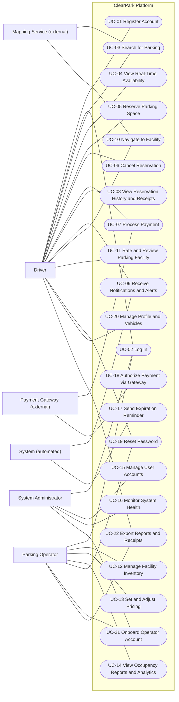
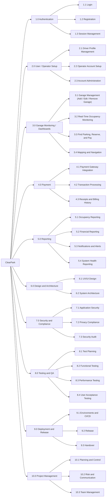
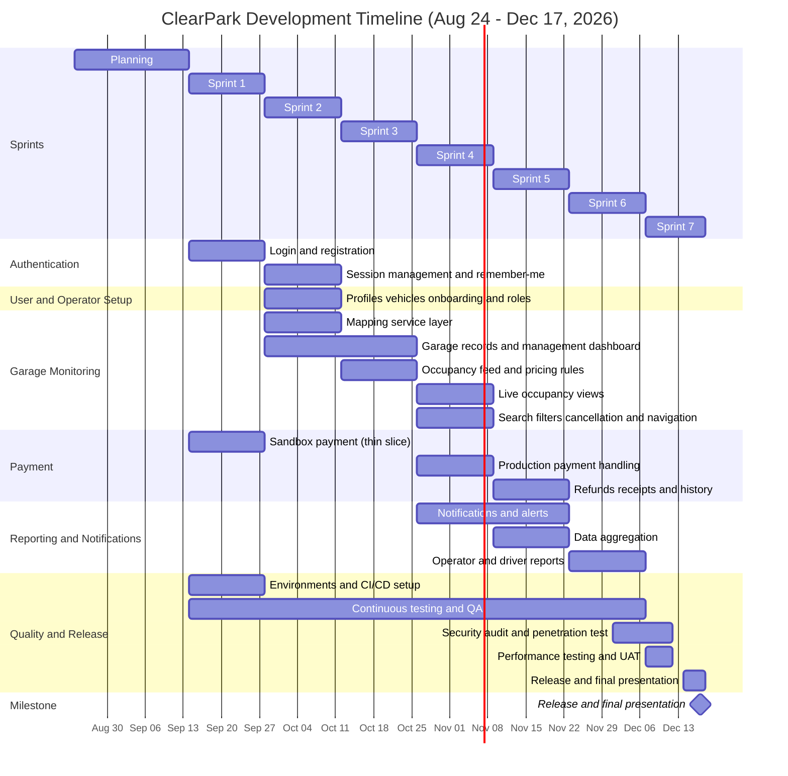

# ClearPark: Smart Parking Platform
### Project Document — WE ARE $oftware ¢orp.

**Course:** CIS 4374 — University of Houston  
**Document Type:** Vision & Scope / Software Requirements Specification / Project Management Plan (Living Document)  
**Version:** 0.6 (Week 6)  
**Author:** David Thai

---

## Version History

| Version | Date | Author | Summary of Changes |
|---|---|---|---|
| 0.1 | Week 1 | David Thai | Initial draft: Research, Vision & Scope, and SRS draft (15+ use cases) created |
| 0.2 | Week 2 (Sept 17, 2026) | David Thai | Added Work Breakdown Structure (3+ levels) and draft project timeline with Gantt chart |
| 0.3 | Week 3 | David Thai | Added product backlog and Sprint 1 plan (Trello board + screenshot) |
| 0.4 | Week 4 | David Thai | Added risk identification (4+ per category), risk register, and communication plan |
| 0.5 | Week 5 | David Thai | Added roles & resources, bottom-up cost plan with monthly cashflow, and RACI matrix |
| 0.6 | Week 6 | David Thai | Project-wide update, no new chapters: SRS, user stories and backlog, WBS, timeline and Gantt, sprints, risks, communication plan, roles, cost plan, and RACI brought up to date and checked against each other (see Week 6 Change Log) |

*(Update this table every week per course instructions: bump the version number and note what changed.)*

### Week 6 Change Log

Week 6 added no new chapters. Every section was reviewed against the others and updated where they disagreed. The table lists what changed and why.

| Section | What Changed | Why |
|---|---|---|
| 2. Vision and Scope | Added deferred items to the out-of-scope list, admin tools to the scope list, and a success criteria subsection (2.8). | Scope had to match the backlog and the requirements, and the project needed measurable goals. |
| 3. SRS | Added 4 use cases (now 22), priorities, a use case diagram, 6 expanded use cases, 35 functional and 13 non-functional requirements, and a traceability matrix. | The backlog and WBS contained work with no use case (password reset, profiles, operator onboarding, exports), and the requirements needed measurable targets before building. |
| User stories and 6. Backlog | Rewrote every backlog item as a user story with priority, points, sprint, and use case; grew the backlog from 49 to 65 items; deferred 3 Could items; added acceptance criteria for Sprint 1. | New use cases, WBS items, and risk mitigations created work that was not in the backlog. |
| 4. WBS | Added components 6.0 to 10.0 (design, security, testing, deployment, project management) and missing items (pricing, stale-data flag, cancellation, navigation, production payments, system health); added an ownership table. | The RACI, roles, cost plan, and risks already referred to work that the WBS did not contain. |
| 5. Timeline and Gantt | Replaced the one-after-another phases with a sprint-based plan where teams work in parallel; added sprint calendar and milestones. | Sprint 1 already included login, search, reservation, and payment, but the old Gantt scheduled those months apart; parallel teams also make a sequential plan unrealistic. |
| 6. Sprints and screenshots | Corrected the Sprint 1 list to all 14 stories on the Trello board (it listed only 10); planned Sprints 2 to 7 with goals and points; added a sprint board screenshot. | The summary said 14 items but the list showed 10, and only Sprint 1 had been planned. |
| 7. Risks | Added T-06 and S-05 (now 19 risks); added status and links from every mitigation to backlog or WBS items; updated mitigations to use new requirements. | Mitigations are only real if they are planned as work, and the review found two risks that were missing. |
| 8. Communication Plan | Added backlog refinement, user feedback sessions, sprint rhythm, a stakeholder communication matrix, and meeting and decision-log standards. | Drivers and mobile users had no defined communication, and risk P-04 depends on a decision log. |
| 9. Roles | Added primary WBS and a backup for every role; added Scrum roles. | Risk P-01 says every role has a backup, but the table did not show them. |
| 10. Cost Plan | Added labor cost by sprint, cost per story point, and budget variance thresholds. Totals did not change. | Costs needed to line up with the sprint plan, and the cost plan needed rules for when to escalate. |
| 11. RACI | Added 6 activities (now 24) and a workload check. | The new WBS components and sprint activities needed owners. |

---

## Table of Contents

1. [Research: Competitive Analysis](#1-research-competitive-analysis)
2. [Vision and Scope](#2-vision-and-scope)
3. [Software Requirements Specification (SRS)](#3-software-requirements-specification-srs)
4. [Work Breakdown Structure (WBS)](#4-work-breakdown-structure-wbs)
5. [Project Timeline & Gantt Chart](#5-project-timeline--gantt-chart)
6. [Product Backlog, User Stories & Sprint Plan](#6-product-backlog-user-stories--sprint-plan)
7. [Risk Management](#7-risk-management)
8. [Communication Plan](#8-communication-plan)
9. [Roles & Resources](#9-roles--resources)
10. [Resource & Cost Plan](#10-resource--cost-plan)
11. [RACI Matrix](#11-raci-matrix)
12. [References](#12-references)

---

## 1. Research: Competitive Analysis

### 1.1 Purpose

Before defining ClearPark's scope, WE ARE $oftware ¢orp. conducted a review of existing smart-parking products to understand the current market landscape, identify gaps, and determine how ClearPark will differentiate itself.

### 1.2 Existing Software Landscape

| Product | Focus | Strengths | Weaknesses |
|---|---|---|---|
| **ParkMobile** | On-street/metered parking, city partnerships | Largest zone coverage in the U.S. (500+ cities); deep integration with municipal parking systems and DOTs | Per-transaction convenience fees; limited focus on off-street garage reservations; GPS-based session tracking can fail to detect when a driver has left, leading to overcharges |
| **SpotHero** | Pre-booked garage/lot/event parking | Strong brand recognition ("#1 Rated Parking App"); partnerships (e.g., Apple Maps integration for 8,000+ locations); good filtering (EV charging, accessibility, valet) | Limited in smaller/secondary cities; pricing can surge between search and checkout, frustrating users |
| **ParkWhiz** | Garage reservations for events, airports, downtown | Deep discounts (up to 50%) for pre-booked spots; easy booking UX | Coverage concentrated in major metro/event markets; less useful for everyday commuter parking |
| **PayByPhone** | Metered/on-street payment, expanding internationally | Official partner in many cities; straightforward pay-by-phone metering | Convenience fees vary by city; minimal reservation or analytics features for operators |
| **Passport** | Municipal & university parking/transit management | Popular with smaller cities and university campuses; consolidates multiple permit/pass types in one app | Less brand recognition in large metros; feature depth varies city to city |
| **SpotAngels** | Community-driven free/street parking finder | Crowdsourced data helps avoid tickets and street-cleaning zones; free to use | No reservation or payment capability; relies on community data accuracy |

### 1.3 Common Pain Points Across Existing Solutions

- **Fragmentation** — drivers often need multiple apps depending on the city or lot (metered vs. garage vs. municipal).
- **Pricing transparency** — several platforms are criticized for prices shown in search differing from checkout totals once fees/surge pricing apply.
- **Session accuracy** — GPS-based auto-detection of arrival/departure is unreliable, causing billing disputes.
- **Operator-side tools** — most consumer-facing apps offer little for the parking facility operator (occupancy analytics, dynamic pricing controls, reporting).

### 1.4 Opportunity for Differentiation

ClearPark will differentiate itself by:

1. **Unifying** on-street, garage, and lot parking into a single real-time map/reservation experience (rather than specializing in only one, like most competitors).
2. Providing a genuine **operator-facing administrative dashboard** with occupancy analytics and pricing tools — a gap in most driver-first competitor apps.
3. Guaranteeing **transparent, locked-in pricing** at time of reservation to directly address the surge-pricing complaint common in competitor reviews.
4. Offering **built-in navigation hand-off** to external mapping/navigation services rather than requiring a separate app.

---

## 2. Vision and Scope

### 2.1 About WE ARE $oftware ¢orp.

WE ARE $oftware ¢orp. is a fictitious software development studio operating with a theoretically unlimited budget and staffed with dedicated teams across mobile, web, backend, mapping, payments, and QA. The studio was approached by a coalition of city transportation departments and independent parking garage operators who share a common problem: drivers can't find real-time parking availability, and operators lack modern digital tools to manage occupancy and pricing.

### 2.2 How This Project Was Acquired

City transportation departments and parking facility operators identified worsening downtown congestion linked directly to drivers circling in search of parking. An RFP (Request for Proposal) was issued for a unified platform that would serve both drivers and parking operators. WE ARE $oftware ¢orp. was selected to design, build, and deliver this platform over the course of the engagement, branded internally as **ClearPark**.

### 2.3 Project Overview

ClearPark is a web and mobile platform that allows drivers to locate, reserve, and pay for parking in real time, while giving parking operators the tools to manage occupancy, pricing, and reporting. The platform addresses a clear business need: drivers lose time and money circling for parking, and operators lack visibility into utilization of their own assets.

### 2.4 Vision Statement

> For drivers who waste time and money searching for parking, and for operators who lack visibility into their facilities, ClearPark is a unified parking platform that provides real-time availability, reservations, and payment in one place — unlike fragmented single-purpose competitor apps, ClearPark serves both sides of the market with transparent pricing and operator-grade analytics.

### 2.5 Project Scope

**In Scope (Semester Deliverable):**
- User registration/authentication
- Real-time parking availability + interactive map
- Reservation and digital payment processing
- Reservation history/receipts
- Notifications/alerts
- Administrative dashboard (occupancy reporting, analytics)
- Integration with third-party mapping/navigation APIs
- Integration with third-party payment providers
- Basic administrative tools (user management and system health monitoring)

**Out of Scope (for now — may be revisited):**
- Autonomous vehicle valet/parking assist
- Physical hardware (sensors, gate systems) — assumed to be provided by facility operators or a future phase
- Dynamic city-wide traffic rerouting
- Driver reviews, a peak-hours heatmap report, and a monthly receipt summary email (deferred to a later release; see Section 6)

### 2.6 Stakeholders

| Stakeholder | Interest |
|---|---|
| Drivers / vehicle owners | Fast, reliable way to find and pay for parking |
| Parking facility operators | Tools to manage occupancy, pricing, and reporting |
| City transportation departments | Reduced congestion, data on parking utilization |
| System administrators | Platform uptime, security, user management |
| Finance and billing personnel | Accurate transaction processing and reconciliation |
| Mobile application users | Seamless mobile experience |
| Third-party payment providers | Reliable integration and transaction volume |

### 2.7 Constraints

- Unlimited theoretical development budget, but a **fixed semester timeline**
- Dependence on third-party mapping and payment APIs
- Must comply with security/privacy regulations and city ordinances

### 2.8 Success Criteria

ClearPark will be considered successful at release (Dec 17, 2026) if:

- A first-time driver can find and reserve a space in under 3 minutes (NFR-08).
- Occupancy shown to drivers is no more than 30 seconds old (NFR-02).
- Driver-facing services reach 99.5% availability (NFR-03).
- Payments are processed through the provider without storing card data and without duplicate charges (FR-19, NFR-06).
- An operator can add a garage and set its pricing in under 5 minutes (FR-27, FR-28).
- All Must-priority use cases pass user acceptance testing with parking operators (Section 6).

---

## 3. Software Requirements Specification (SRS)

*This section is a living document. It was expanded in Week 6 with additional use cases, functional and non-functional requirements, and a traceability matrix.*

### 3.1 Use Case Overview

The use case set covers driver, operator, administrator, and system interactions identified from the high-level requirements in the project brief, the stakeholder analysis, and the backlog work in later weeks. Priorities use MoSCoW (Must, Should, Could).

**Actors:** Driver, Parking Operator, System Administrator, Payment Gateway (external), Mapping Service (external), System (automated).

*Figure 1: Use case diagram showing the actors and the 22 use cases of the ClearPark platform.*

### 3.2 Use Cases

| ID | Use Case | Primary Actor | Priority | WBS | Description |
|---|---|---|---|---|---|
| UC-01 | Register Account | Driver | Must | 1.2 | Driver creates a new account with email and password. |
| UC-02 | Log In | Driver, Operator, Administrator | Must | 1.1, 1.3 | A registered user authenticates to access the platform. |
| UC-03 | Search for Parking | Driver | Must | 3.3.1 | Driver searches for parking near a destination using the map or an address. |
| UC-04 | View Real-Time Availability | Driver | Must | 3.2 | Driver views live availability, price, and hours for nearby facilities. |
| UC-05 | Reserve Parking Space | Driver | Must | 3.3.2 | Driver selects a facility and time window and confirms a reservation. |
| UC-06 | Cancel Reservation | Driver | Must | 3.3.4, 4.2.2 | Driver cancels a reservation before it starts. |
| UC-07 | Process Payment | Driver | Must | 4.1, 4.2 | Driver pays for a reservation digitally. |
| UC-08 | View Reservation History and Receipts | Driver | Should | 4.3 | Driver reviews past reservations and opens receipts. |
| UC-09 | Receive Notifications and Alerts | Driver, Operator | Should | 5.3 | Users receive confirmations, reminders, and alerts. |
| UC-10 | Navigate to Facility | Driver | Should | 3.4 | Driver gets turn-by-turn directions through an external navigation service. |
| UC-11 | Rate and Review Parking Facility | Driver | Could | 3.3.5 | Driver rates a facility after a completed session (deferred). |
| UC-12 | Manage Facility Inventory | Parking Operator | Must | 3.1 | Operator adds, edits, and deactivates facilities, spaces, and hours. |
| UC-13 | Set and Adjust Pricing | Parking Operator | Must | 3.1.4 | Operator configures pricing rules for a facility. |
| UC-14 | View Occupancy Reports and Analytics | Parking Operator | Must | 3.2, 5.1, 5.2 | Operator views occupancy and revenue dashboards and reports. |
| UC-15 | Manage User Accounts | System Administrator | Should | 2.3 | Administrator manages accounts, roles, and access. |
| UC-16 | Monitor System Health | System Administrator | Should | 5.4, 7.1 | Administrator monitors uptime, error logs, and integration status. |
| UC-17 | Send Expiration Reminder | System | Should | 5.3.1 | System notifies a driver before a reservation or session expires. |
| UC-18 | Authorize Payment via Gateway | Payment Gateway (external) | Must | 4.1 | External provider authorizes and settles a payment initiated by the platform. |
| UC-19 | Reset Password | Driver, Operator | Must | 1.1.3 | User resets a forgotten password through a time-limited link. |
| UC-20 | Manage Profile and Vehicles | Driver | Should | 2.1, 7.2.2 | Driver edits profile and saved vehicles and can export or delete personal data. |
| UC-21 | Onboard Operator Account | Operator, System Administrator | Must | 2.2 | A new operator account is approved, set up, and given facility access. |
| UC-22 | Export Reports and Receipts | Driver, Operator | Should | 4.3.1, 5.2.2 | Users export receipts and financial reports to PDF or CSV. |

*22 use cases (18 from Week 1 plus UC-19 to UC-22 added in Week 6). The new ones cover work already in the WBS and backlog that had no use case: password reset, profile and vehicle management, operator onboarding, and report/receipt export.*

#### 3.2.1 Expanded Use Cases

The six use cases below are described in full. The remaining use cases will be expanded as their sprints approach.

**UC-02 - Log In**

| Field | Detail |
|---|---|
| Primary actor | Driver, Operator, Administrator |
| Preconditions | The user has a registered, active account. |
| Trigger | User opens the app or website and selects Log In. |
| Main flow | 1. User enters email and password. 2. System validates the input format. 3. System authenticates the credentials (FR-03). 4. System creates a session: 30-minute inactivity timeout, or 30 days if 'remember me' is selected (FR-05). 5. System opens the home screen for the user's role: map for drivers, dashboard for operators, console for administrators (FR-04). |
| Alternate and exception flows | Invalid credentials: system shows a generic error and logs the attempt. After 5 failed attempts the account is locked for 15 minutes. Forgotten password: user starts UC-19. Deactivated account: system tells the user to contact support. |
| Postconditions | A valid session exists and the login event is logged. |
| Related requirements | FR-03, FR-04, FR-05; NFR-05 |

**UC-05 - Reserve Parking Space**

| Field | Detail |
|---|---|
| Primary actor | Driver |
| Preconditions | The driver is logged in and at least one facility has an available space. |
| Trigger | Driver selects a facility and a time window. |
| Main flow | 1. Driver selects a facility from the map or list (UC-04). 2. System shows time slots, availability, and price. 3. Driver selects a time window and a saved vehicle. 4. System holds a space for up to 10 minutes and locks the price (FR-15, FR-18). 5. Driver confirms and system requests payment (UC-07). 6. On payment success, system confirms the reservation, shows the reservation code, and sends a notification (UC-09). |
| Alternate and exception flows | The slot becomes unavailable before confirmation: system tells the driver and offers other slots. The hold expires: system releases the space and asks the driver to start again. Payment fails: system keeps the hold during a short retry window, then releases it. |
| Postconditions | A confirmed reservation exists, the space is held for the reserved window, and a receipt is created. |
| Related requirements | FR-14, FR-15, FR-16, FR-18 |

**UC-06 - Cancel Reservation**

| Field | Detail |
|---|---|
| Primary actor | Driver |
| Preconditions | The driver is logged in and has a confirmed reservation that has not started. |
| Trigger | Driver chooses Cancel on a reservation. |
| Main flow | 1. Driver opens reservation history and selects the reservation. 2. System shows the cancellation policy and refund amount. 3. Driver confirms the cancellation. 4. System cancels the reservation and releases the space. 5. System starts the refund through the payment provider (UC-18). 6. System sends a cancellation notification (UC-09). |
| Alternate and exception flows | The reservation has already started: cancellation is blocked and the driver is told to contact the operator. The refund fails: the refund is marked pending and retried; the driver is informed. |
| Postconditions | The reservation is cancelled, the space is available again, and the refund is initiated. |
| Related requirements | FR-17, FR-20 |

**UC-07 - Process Payment**

| Field | Detail |
|---|---|
| Primary actor | Driver (Payment Gateway as secondary actor) |
| Preconditions | A reservation hold exists and the price is locked. |
| Trigger | Driver proceeds to checkout. |
| Main flow | 1. System shows the locked total price. 2. Driver chooses a payment method (card or digital wallet). 3. System sends the payment to the provider's hosted checkout using tokenization. 4. The provider authorizes the payment (UC-18). 5. System records the transaction token and status. 6. System generates a digital receipt and confirms the reservation (FR-21). |
| Alternate and exception flows | Payment declined: the driver can retry or change method. Provider timeout: the system checks the transaction status before any retry so the driver is never charged twice. |
| Postconditions | The payment is recorded, the receipt is available, and no card number is stored. |
| Related requirements | FR-19, FR-21; NFR-06 |

**UC-12 - Manage Facility Inventory**

| Field | Detail |
|---|---|
| Primary actor | Parking Operator |
| Preconditions | The operator is logged in with an approved operator account. |
| Trigger | Operator opens the garage dashboard and selects Add Garage or Edit. |
| Main flow | 1. Operator selects Add Garage or an existing garage. 2. Operator enters or edits name, address, capacity, hours, and amenities. 3. System validates the data and saves it. 4. System updates the driver-facing map. |
| Alternate and exception flows | Garage has future reservations: the system blocks removal until they are cancelled or moved. Invalid address: the system asks the operator to correct it. |
| Postconditions | The facility record is saved, the change is logged, and drivers see the update. |
| Related requirements | FR-27, FR-29 |

**UC-14 - View Occupancy Reports and Analytics**

| Field | Detail |
|---|---|
| Primary actor | Parking Operator |
| Preconditions | The operator is logged in and owns at least one facility. |
| Trigger | Operator opens Reports. |
| Main flow | 1. Operator selects a facility, a date range, and a period (daily, weekly, monthly). 2. System aggregates occupancy and revenue data. 3. System shows charts and tables. 4. Operator optionally exports the report (UC-22). |
| Alternate and exception flows | No data for the range: the system shows a message. Very large range: the system builds the report in the background and notifies the operator when ready. |
| Postconditions | The report is displayed and access is logged. |
| Related requirements | FR-30, FR-31 |

### 3.3 Functional Requirements

Each requirement is traced to at least one use case. Priority uses MoSCoW.

| ID | Requirement | Use Cases | Priority |
|---|---|---|---|
| FR-01 | The system shall allow a driver to register an account with an email address and password. | UC-01 | Must |
| FR-02 | The system shall send an email verification link and require verification before a new account can make reservations. | UC-01 | Should |
| FR-03 | The system shall authenticate users by email and password and issue a session token. | UC-02 | Must |
| FR-04 | The system shall support driver, operator, and administrator roles with role-based access control. | UC-02, UC-15, UC-21 | Must |
| FR-05 | The system shall end a session after 30 minutes of inactivity, or after 30 days if the user selected 'remember me'. | UC-02 | Must |
| FR-06 | The system shall let a user reset a forgotten password through a single-use link that expires after 1 hour. | UC-19 | Must |
| FR-07 | The system shall let a driver create and edit a profile and saved vehicles. | UC-20 | Should |
| FR-08 | The system shall let an administrator create, edit, deactivate, and delete user accounts. | UC-15 | Should |
| FR-09 | The system shall let an administrator approve operator accounts and assign them to facilities. | UC-21 | Must |
| FR-10 | The system shall display nearby parking facilities on an interactive map and allow search by address. | UC-03, UC-04 | Must |
| FR-11 | The system shall show each facility's available spaces, price, and hours in real time. | UC-04 | Must |
| FR-12 | The system shall let drivers filter facilities by price and distance. | UC-03 | Should |
| FR-13 | The system shall show when occupancy data was last updated and flag data older than 2 minutes as stale. | UC-04 | Must |
| FR-14 | The system shall let a driver reserve a space for a chosen time window. | UC-05 | Must |
| FR-15 | The system shall hold a space for up to 10 minutes during checkout so that two drivers cannot reserve the same space. | UC-05 | Must |
| FR-16 | The system shall show a confirmation with a reservation code, facility, time window, and price. | UC-05 | Must |
| FR-17 | The system shall let a driver cancel a reservation before its start time according to the facility's cancellation policy. | UC-06 | Must |
| FR-18 | The system shall lock the price shown at reservation time so that it cannot change before checkout. | UC-05, UC-07 | Must |
| FR-19 | The system shall accept card and digital-wallet payments through a third-party provider and shall not store full card numbers. | UC-07, UC-18 | Must |
| FR-20 | The system shall refund cancelled reservations according to the cancellation policy. | UC-06, UC-18 | Should |
| FR-21 | The system shall generate a digital receipt for every completed payment. | UC-08 | Must |
| FR-22 | The system shall show reservation history and let drivers download receipts as PDF. | UC-08, UC-22 | Should |
| FR-23 | The system shall open turn-by-turn directions to a reserved facility in an external navigation service. | UC-10 | Should |
| FR-24 | The system shall send confirmation, reminder, and cancellation notices by push notification or email. | UC-09, UC-17 | Should |
| FR-25 | The system shall let users manage their notification preferences. | UC-09 | Should |
| FR-26 | The system shall let a driver rate and review a facility after a completed session (deferred). | UC-11 | Could |
| FR-27 | The system shall let an operator add, edit, and deactivate facilities, including location, capacity, and hours. | UC-12 | Must |
| FR-28 | The system shall let an operator configure hourly, daily, and event pricing rules for each facility. | UC-13 | Must |
| FR-29 | The system shall accept occupancy updates from facility sensors or operator systems through an API and allow manual override by the operator. | UC-12, UC-14 | Must |
| FR-30 | The system shall show operators a real-time occupancy dashboard for each of their facilities. | UC-14 | Must |
| FR-31 | The system shall provide occupancy and revenue reports by day, week, and month. | UC-14 | Must |
| FR-32 | The system shall export financial reports to CSV and PDF. | UC-22 | Should |
| FR-33 | The system shall alert operators when occupancy crosses configurable thresholds. | UC-09, UC-14 | Should |
| FR-34 | The system shall log errors and security events and give administrators a system health dashboard. | UC-16 | Should |
| FR-35 | The system shall let a user request an export or deletion of their personal data. | UC-20 | Should |

### 3.4 Non-Functional Requirements

| ID | Category | Requirement (measurable) | Verification |
|---|---|---|---|
| NFR-01 | Performance | Search results and the map load within 2 seconds for 95% of requests under normal load. | Load test |
| NFR-02 | Data freshness | Occupancy changes appear to drivers within 30 seconds of the facility feed event. | Integration test |
| NFR-03 | Availability | Driver-facing services are available 99.5% of the time each month. | Uptime monitoring |
| NFR-04 | Scalability | The system supports 10,000 concurrent users and 500 facilities without degraded response times. | Load test |
| NFR-05 | Security | All traffic uses TLS 1.2 or higher, passwords are stored as salted hashes, data is encrypted at rest, and OWASP Top 10 risks are addressed. | Penetration test and code scan |
| NFR-06 | Payment security | Payments use provider tokenization so the platform stays within PCI-DSS scope reduction; no card data is stored. | Provider certification and audit |
| NFR-07 | Privacy and legal | Personal and location data is collected only as needed, retained per a defined policy, and handled in line with applicable privacy law and city ordinances. | Privacy review |
| NFR-08 | Usability | A first-time driver can find and reserve a space in under 3 minutes. | Usability test with at least 5 drivers |
| NFR-09 | Accessibility | The web application conforms to WCAG 2.1 level AA. | Accessibility audit |
| NFR-10 | Compatibility | The apps run on the current and previous major iOS versions, Android 10 and later, and the latest two versions of Chrome, Safari, Edge, and Firefox. | Device and browser matrix testing |
| NFR-11 | Recoverability | Data is backed up daily with a recovery point of 15 minutes or less and a recovery time of 4 hours or less. | Disaster recovery test |
| NFR-12 | Maintainability | Automated tests cover at least 70% of backend code and all APIs are documented with OpenAPI. | CI reports |
| NFR-13 | Auditability | Administrative and financial actions are logged with user and timestamp and kept for 1 year. | Log review |

### 3.5 Assumptions, Dependencies, and Constraints

- **Third-party services:** mapping/navigation and payment providers are external dependencies; sandbox access is assumed to be available from the first sprint (risk S-02).
- **Hardware:** occupancy sensors and gate systems are provided by facility operators; ClearPark consumes their data through an API (out of scope: building hardware).
- **Compliance:** the platform must follow applicable security and privacy requirements and city ordinances (NFR-05, NFR-07).
- **Timeline:** the project window is fixed (Aug 24 to Dec 17, 2026), so scope is flexed before the date is moved.
- **Cancellation policy:** each facility defines its own cancellation window; the platform enforces it but does not set it.

### 3.6 Requirements Traceability Matrix

Links each use case to its requirements, WBS elements, backlog items, and planned sprints.

| Use Case | Name | Functional Requirements | WBS | Backlog Items | Sprints |
|---|---|---|---|---|---|
| UC-01 | Register Account | FR-01, FR-02 | 1.2 | LG-01, BE-01 | S1 |
| UC-02 | Log In | FR-03, FR-04, FR-05 | 1.1, 1.3 | LG-02, LG-04, LG-05, LG-06, LG-07, BE-02, BE-22, BE-24 | S1, S2, S7 |
| UC-03 | Search for Parking | FR-10, FR-12 | 3.3.1 | UI-01, UI-02, UI-03, BE-03, BE-17 | S1, S2, S4 |
| UC-04 | View Real-Time Availability | FR-10, FR-11, FR-13 | 3.2 | UI-01, UI-04, BE-03, BE-11, BE-23 | S1, S3, S7 |
| UC-05 | Reserve Parking Space | FR-14, FR-15, FR-16, FR-18 | 3.3.2 | UI-05, BE-04, BE-23 | S1, S7 |
| UC-06 | Cancel Reservation | FR-17, FR-20 | 3.3.4, 4.2.2 | UI-17, BE-05, BE-18 | S4, S5 |
| UC-07 | Process Payment | FR-18, FR-19 | 4.1, 4.2 | UI-07, BE-06, BE-19, BE-24 | S1, S4, S7 |
| UC-08 | View Reservation History and Receipts | FR-21, FR-22 | 4.3 | UI-06, BE-07, BE-09, RP-01, RP-03, RP-11 | S5, S6, Deferred |
| UC-09 | Receive Notifications and Alerts | FR-24, FR-25, FR-33 | 5.3 | UI-19, BE-08, RP-12 | S4, S5 |
| UC-10 | Navigate to Facility | FR-23 | 3.4 | UI-18, BE-17 | S2, S4 |
| UC-11 | Rate and Review Parking Facility | FR-26 | 3.3.5 | UI-09 | Deferred |
| UC-12 | Manage Facility Inventory | FR-27, FR-29 | 3.1 | UI-10, UI-11, UI-12, BE-10 | S2, S3 |
| UC-13 | Set and Adjust Pricing | FR-28 | 3.1.4 | UI-14, BE-12 | S3 |
| UC-14 | View Occupancy Reports and Analytics | FR-29, FR-30, FR-31, FR-33 | 3.2, 5.1, 5.2 | UI-13, UI-15, BE-11, BE-13, BE-14, RP-04, RP-05, RP-07, RP-09, RP-10, RP-12 | S3, S4, S5, S6, Deferred |
| UC-15 | Manage User Accounts | FR-04, FR-08 | 2.3 | UI-22, BE-15 | S2 |
| UC-16 | Monitor System Health | FR-34 | 5.4, 7.1 | BE-16, BE-20, RP-08 | S2, S3, S6 |
| UC-17 | Send Expiration Reminder | FR-24 | 5.3.1 | BE-08 | S4 |
| UC-18 | Authorize Payment via Gateway | FR-19, FR-20 | 4.1 | BE-06, BE-18, BE-19 | S1, S4, S5 |
| UC-19 | Reset Password | FR-06 | 1.1.3 | LG-03 | S1 |
| UC-20 | Manage Profile and Vehicles | FR-07, FR-35 | 2.1, 7.2.2 | UI-08, UI-20, BE-21 | S2, S5 |
| UC-21 | Onboard Operator Account | FR-04, FR-09 | 2.2 | UI-16, UI-21, BE-15 | S2, S3 |
| UC-22 | Export Reports and Receipts | FR-22, FR-32 | 4.3.1, 5.2.2 | RP-02, RP-06 | S5, S6 |

---

## 4. Work Breakdown Structure (WBS)

The WBS decomposes ClearPark into its five product components from class (Authentication, User/Operator Setup, Garage Monitoring/Dashboards, Payment, Reporting) and, since Week 6, five supporting components (Design and Architecture, Security and Compliance, Testing and QA, Deployment and Release, Project Management). Every branch is at least three levels deep. WBS numbers (for example 3.2.1) are WBS IDs and are separate from the numbering of the sections of this document.

*Figure 2: WBS overview showing levels 1 and 2. Level 3 tasks are listed below.*

### 4.1 Authentication

- **1.0 Authentication**
  - 1.1 Login
    - 1.1.1 Design login UI
    - 1.1.2 Implement email/password authentication
    - 1.1.3 Implement forgot-password flow
    - 1.1.4 Implement remember-me option
  - 1.2 Registration
    - 1.2.1 Design registration form
    - 1.2.2 Implement driver registration
    - 1.2.3 Implement operator registration
  - 1.3 Session Management
    - 1.3.1 Implement session token generation
    - 1.3.2 Implement token refresh and auto-logout on expiration
    - 1.3.3 Implement secure logout

### 4.2 User / Operator Setup

- **2.0 User / Operator Setup**
  - 2.1 Driver Profile Management
    - 2.1.1 Create/edit profile
    - 2.1.2 Manage saved vehicle information
  - 2.2 Operator Account Setup
    - 2.2.1 Operator onboarding workflow
    - 2.2.2 Role and permission assignment
    - 2.2.3 Operator account settings
  - 2.3 Account Administration
    - 2.3.1 Admin tools to view/edit/deactivate accounts

### 4.3 Garage Monitoring / Dashboards

- **3.0 Garage Monitoring / Dashboards**
  - 3.1 Garage Management (Add / Edit / Remove Garage)
    - 3.1.1 Add new garage facility (location, capacity, hours)
    - 3.1.2 Edit garage details
    - 3.1.3 Deactivate/remove a garage
    - 3.1.4 Configure pricing rules
  - 3.2 Real-Time Occupancy Monitoring
    - 3.2.1 Integrate occupancy data feed/sensor API
    - 3.2.2 Build live occupancy map view
    - 3.2.3 Show last-updated time and flag stale data
  - 3.3 Find Parking, Reserve, and Pay
    - 3.3.1 Build search/filter interface
    - 3.3.2 Build reservation selection flow
    - 3.3.3 Hand off to Payment checkout (see 4.0)
    - 3.3.4 Cancel reservation
    - 3.3.5 Rate and review facility (deferred)
  - 3.4 Mapping and Navigation
    - 3.4.1 Build mapping service layer (geocoding and routing)
    - 3.4.2 Navigation hand-off to external maps app

### 4.4 Payment

- **4.0 Payment**
  - 4.1 Payment Gateway Integration
    - 4.1.1 Select third-party payment provider
    - 4.1.2 Implement provider API integration (sandbox first)
  - 4.2 Transaction Processing
    - 4.2.1 Process reservation/on-demand payments
    - 4.2.2 Handle refunds and cancellations
    - 4.2.3 Production payment handling (retries, idempotency, reconciliation)
  - 4.3 Receipts and Billing History
    - 4.3.1 Generate digital receipts
    - 4.3.2 Build reservation/payment history view

### 4.5 Reporting

- **5.0 Reporting**
  - 5.1 Occupancy Reporting
    - 5.1.1 Build occupancy graphs/charts
    - 5.1.2 Historical trend analysis
  - 5.2 Financial Reporting
    - 5.2.1 Build revenue reports
    - 5.2.2 Export financial reports (CSV/PDF)
  - 5.3 Notifications and Alerts
    - 5.3.1 Reservation/expiration alerts to drivers
    - 5.3.2 Occupancy threshold alerts to operators
  - 5.4 System Health Reporting
    - 5.4.1 Uptime and error dashboard for administrators

### 4.6 Supporting Components

- **6.0 Design and Architecture**
  - 6.1 UX/UI Design
    - 6.1.1 Wireframes for driver and operator flows
    - 6.1.2 Interactive prototypes
    - 6.1.3 Usability review
  - 6.2 System Architecture
    - 6.2.1 Select tech stack
    - 6.2.2 Design data model
    - 6.2.3 Define API contracts

- **7.0 Security and Compliance**
  - 7.1 Application Security
    - 7.1.1 Audit logging and input validation
    - 7.1.2 Rate limiting and API protection
  - 7.2 Privacy Compliance
    - 7.2.1 Review privacy rules and city ordinances
    - 7.2.2 User data export and delete
  - 7.3 Security Audit
    - 7.3.1 Internal code scans
    - 7.3.2 Third-party penetration test
    - 7.3.3 Remediate findings

- **8.0 Testing and QA**
  - 8.1 Test Planning
    - 8.1.1 Define test strategy
    - 8.1.2 Write test cases from use cases
  - 8.2 Functional Testing
    - 8.2.1 Automated regression suite
    - 8.2.2 Mobile device testing
  - 8.3 Performance Testing
    - 8.3.1 Load testing
    - 8.3.2 Performance tuning
  - 8.4 User Acceptance Testing
    - 8.4.1 UAT with operators and drivers
    - 8.4.2 Sign-off

- **9.0 Deployment and Release**
  - 9.1 Environments and CI/CD
    - 9.1.1 Set up dev/staging/production environments
    - 9.1.2 Build CI/CD pipelines
  - 9.2 Release
    - 9.2.1 Release readiness review
    - 9.2.2 Production deployment
    - 9.2.3 Post-release monitoring
  - 9.3 Handover
    - 9.3.1 User guides
    - 9.3.2 Operator training materials

- **10.0 Project Management**
  - 10.1 Planning and Control
    - 10.1.1 Sprint and schedule planning
    - 10.1.2 Budget tracking
    - 10.1.3 Change control
  - 10.2 Risk and Communication
    - 10.2.1 Risk register reviews
    - 10.2.2 Status reporting and stakeholder updates
  - 10.3 Team Management
    - 10.3.1 Resource allocation
    - 10.3.2 Sprint retrospectives

### 4.7 WBS Ownership Summary

| WBS | Component | Accountable | Teams Involved | Sprints |
|---|---|---|---|---|
| 1.0 | Authentication | Tomas Alvarez (Backend/API Lead) | Backend, Mobile, Web | S1-S2 |
| 2.0 | User / Operator Setup | Tomas Alvarez (Backend/API Lead) | Backend, Web, Mobile | S2 |
| 3.0 | Garage Monitoring / Dashboards | Aisha Khan (Web Lead); 3.4 Ravi Nair (Mapping) | Web, Backend, Mapping, Mobile | S2-S4 |
| 4.0 | Payment | Chloe Dubois (Payment Engineer) | Payment, Backend, Mobile, Web | S1, S4-S5 |
| 5.0 | Reporting | Tomas Alvarez (Backend/API Lead) | Backend, Web | S4-S6 |
| 6.0 | Design and Architecture | Priya Patel (6.1); Elena Volkov (6.2) | UX, Architecture | Planning-S2 |
| 7.0 | Security and Compliance | Victor Santos (DevOps/Security) | DevOps/Security, Backend, QA | S2-S7 |
| 8.0 | Testing and QA | Omar Hassan (QA Lead) | QA, all dev teams | S1-S7 |
| 9.0 | Deployment and Release | Victor Santos (DevOps/Security) | DevOps/Security, QA | S1, S7 |
| 10.0 | Project Management | Dana Rivera (Project Manager) | PM, BA, all leads | All |

*Changes in Week 6: added pricing rules (3.1.4), stale-data flag (3.2.3), cancellation (3.3.4), the mapping and navigation branch (3.4), production payment handling (4.2.3), and system health reporting (5.4), plus components 6.0 to 10.0. These were added because the RACI, roles, cost plan, risks, and use cases already referred to this work but it was missing from the WBS.*

---

## 5. Project Timeline & Gantt Chart

The timeline was rebuilt in Week 6 around two-week sprints. The earlier draft scheduled the components one after another, but the team structure (Mobile, Web, Backend, Mapping, Payment, QA working at the same time) and the Sprint 1 plan, which already includes login, search, reservation, and payment, require work to run in parallel. Sprint 1 delivers a thin end-to-end slice (a "walking skeleton") on mock and sandbox data; the component rows below show when each area is built out fully.

### 5.1 Sprint Calendar

| Sprint | Dates | Goal | Review / Demo |
|---|---|---|---|
| Planning | Aug 24, 2026 - Sep 13, 2026 | Research, vision and scope, WBS, schedule, backlog, and planning baseline | - |
| Sprint 1 | Sep 14, 2026 - Sep 27, 2026 | Walking skeleton: register/log in plus a thin end-to-end slice (map, garage detail, reserve, sandbox payment) on mock data | Sep 25, 2026 |
| Sprint 2 | Sep 28, 2026 - Oct 11, 2026 | Authentication hardening, user/operator setup, role-based access, security foundations, mapping service layer, garage records API | Oct 9, 2026 |
| Sprint 3 | Oct 12, 2026 - Oct 25, 2026 | Garage management dashboard, pricing rules, and live occupancy feed integration | Oct 23, 2026 |
| Sprint 4 | Oct 26, 2026 - Nov 8, 2026 | Real-time occupancy views, search filters, cancellation, navigation hand-off, notifications, production payment handling | Nov 6, 2026 |
| Sprint 5 | Nov 9, 2026 - Nov 22, 2026 | Receipts, history, refunds, privacy controls, data aggregation, and occupancy alerts | Nov 20, 2026 |
| Sprint 6 | Nov 23, 2026 - Dec 6, 2026 | Reporting and analytics for operators and drivers; system health report | Dec 4, 2026 |
| Sprint 7 | Dec 7, 2026 - Dec 17, 2026 | Hardening: load testing, security remediation, UAT, and release | Dec 16, 2026 |

### 5.2 Component Schedule

| Component | Task | WBS | Start | End | Duration | Sprint(s) |
|---|---|---|---|---|---|---|
| Planning | Research, vision and scope | Ch. 1-2 | Aug 24, 2026 | Aug 30, 2026 | 1 wk | Planning |
| Planning | WBS, schedule, backlog and planning baseline | Ch. 4-6 | Aug 31, 2026 | Sep 13, 2026 | 2 wk | Planning |
| Authentication | Login and registration | 1.1, 1.2 | Sep 14, 2026 | Sep 27, 2026 | 2 wk | S1 |
| Authentication | Session management and remember-me | 1.3, 1.1.4 | Sep 28, 2026 | Oct 11, 2026 | 2 wk | S2 |
| User and Operator Setup | Profiles, vehicles, onboarding, and roles | 2.1-2.3 | Sep 28, 2026 | Oct 11, 2026 | 2 wk | S2 |
| Garage Monitoring | Mapping service layer | 3.4.1 | Sep 28, 2026 | Oct 11, 2026 | 2 wk | S2 |
| Garage Monitoring | Garage records and management dashboard | 3.1 | Sep 28, 2026 | Oct 25, 2026 | 4 wk | S2-S3 |
| Garage Monitoring | Occupancy feed and pricing rules | 3.2.1, 3.1.4 | Oct 12, 2026 | Oct 25, 2026 | 2 wk | S3 |
| Garage Monitoring | Live occupancy views | 3.2.2, 3.2.3 | Oct 26, 2026 | Nov 8, 2026 | 2 wk | S4 |
| Garage Monitoring | Search filters, cancellation, and navigation | 3.3, 3.4.2 | Oct 26, 2026 | Nov 8, 2026 | 2 wk | S4 |
| Payment | Sandbox payment (thin slice) | 4.1 | Sep 14, 2026 | Sep 27, 2026 | 2 wk | S1 |
| Payment | Production payment handling | 4.2.3 | Oct 26, 2026 | Nov 8, 2026 | 2 wk | S4 |
| Payment | Refunds, receipts, and history | 4.2.2, 4.3 | Nov 9, 2026 | Nov 22, 2026 | 2 wk | S5 |
| Reporting and Notifications | Notifications and alerts | 5.3 | Oct 26, 2026 | Nov 22, 2026 | 4 wk | S4-S5 |
| Reporting and Notifications | Data aggregation | 5.1, 5.2 | Nov 9, 2026 | Nov 22, 2026 | 2 wk | S5 |
| Reporting and Notifications | Operator and driver reports | 5.1, 5.2, 5.4 | Nov 23, 2026 | Dec 6, 2026 | 2 wk | S6 |
| Quality and Release | Environments and CI/CD setup | 9.1 | Sep 14, 2026 | Sep 27, 2026 | 2 wk | S1 |
| Quality and Release | Continuous testing and QA | 8.1, 8.2 | Sep 14, 2026 | Dec 6, 2026 | 12 wk | S1-S6 |
| Quality and Release | Security audit and penetration test | 7.3 | Dec 1, 2026 | Dec 11, 2026 | 1.6 wk | S6-S7 |
| Quality and Release | Performance testing and UAT | 8.3, 8.4 | Dec 7, 2026 | Dec 11, 2026 | 0.7 wk | S7 |
| Quality and Release | Release and final presentation | 9.2 | Dec 14, 2026 | Dec 17, 2026 | 0.6 wk | S7 |

### 5.3 Gantt Chart

*Figure 3: Gantt chart showing the seven sprints and the component tasks that run inside them. The chart renders automatically on GitHub; in a Word version, use a screenshot of the rendered chart.*

### 5.4 Key Milestones

| ID | Date | Milestone |
|---|---|---|
| M1 | Sep 13, 2026 | Planning baseline complete (vision, WBS, schedule, backlog) |
| M2 | Sep 25, 2026 | Sprint 1 demo: walking skeleton (login plus thin reserve-and-pay slice) |
| M3 | Oct 9, 2026 | Authentication, user/operator setup, and security foundations complete |
| M4 | Oct 23, 2026 | Garage management, pricing rules, and occupancy feed complete |
| M5 | Nov 6, 2026 | Real-time monitoring and full reservation flow complete |
| M6 | Nov 20, 2026 | Payments, receipts, and data services complete |
| M7 | Dec 4, 2026 | Reporting complete; feature freeze |
| M8 | Dec 11, 2026 | Security audit complete and UAT sign-off |
| M9 | Dec 17, 2026 | Release and final presentation |

*Dates are baseline estimates and will be re-planned using the real velocity measured at the end of Sprint 1.*

---

## 6. Product Backlog, User Stories & Sprint Plan

### 6.1 Tool and Working Agreements

The backlog and sprints are managed in **Trello**, on a board named "ClearPark Backlog" with one list per category (Login, UI, Backend Processes, Reporting) and one list per sprint. Every item is written as a user story.

**Definition of Ready:** the story has a clear user story statement, acceptance criteria, a priority, a point estimate, and no unresolved dependencies.

**Definition of Done:** acceptance criteria are met; code is reviewed; automated tests pass; the feature works on the staging environment; no critical defects remain; documentation is updated; and the feature can be shown in the sprint demo.

### 6.2 Backlog Summary

| List | Week 3 | Week 6 | Minimum Required | Status |
|---|---|---|---|---|
| Login | 6 | 7 | 5 | Met |
| UI (Operator & User) | 16 | 22 | 15 | Met |
| Backend Processes | 16 | 24 | 15 | Met |
| Reporting | 11 | 12 | 10 | Met |
| **Total** | **49** | **65** |  |  |

*The backlog grew from 49 to 65 items (16 new stories) because the use cases, WBS, risks, and requirements added in later weeks created work that was not yet in the backlog. Total estimate: 226 story points. Three Could-priority items (UI-09, RP-07, RP-11) are deferred to a later release to protect the fixed deadline (risk S-01).*

### 6.3 Product Backlog (User Stories)

Points use a Fibonacci-style scale (1, 2, 3, 5, 8). Status shows whether the story came from the Week 3 board or was added in Week 6. UC is the related use case from Section 3.

**Login**

| ID | User Story | Priority | Pts | Sprint | UC | Status |
|---|---|---|---|---|---|---|
| LG-01 | As a driver, I want to register with my email and a password so that I can create an account. | Must | 2 | Sprint 1 | UC-01 | Original |
| LG-02 | As a driver, I want to log in with my credentials so that I can access the app. | Must | 2 | Sprint 1 | UC-02 | Original |
| LG-03 | As a driver, I want to reset a forgotten password so that I can regain access to my account. | Must | 3 | Sprint 1 | UC-19 | Original |
| LG-04 | As an operator, I want a separate login role so that I can access the admin dashboard. | Must | 3 | Sprint 1 | UC-02 | Original |
| LG-05 | As a system, I want sessions to auto-expire after inactivity so that accounts stay secure. | Must | 2 | Sprint 1 | UC-02 | Original |
| LG-06 | As a driver, I want a 'remember me' option so that I do not have to log in every time. | Should | 2 | Sprint 2 | UC-02 | Original |
| LG-07 | As a driver, I want to log out and have my session token refreshed securely so that my account stays protected on shared devices. | Must | 3 | Sprint 2 | UC-02 | New |

**UI (Operator & User)**

| ID | User Story | Priority | Pts | Sprint | UC | Status |
|---|---|---|---|---|---|---|
| UI-01 | As a driver, I want a map view of nearby parking availability so that I can quickly see my options. | Must | 3 | Sprint 1 | UC-03, UC-04 | Original |
| UI-02 | As a driver, I want to filter results by price so that I can find affordable parking. | Should | 2 | Sprint 4 | UC-03 | Original |
| UI-03 | As a driver, I want to filter results by distance so that I can park close to my destination. | Should | 2 | Sprint 4 | UC-03 | Original |
| UI-04 | As a driver, I want a garage detail screen so that I can review price, hours, and availability before reserving. | Must | 2 | Sprint 1 | UC-04 | Original |
| UI-05 | As a driver, I want a reservation confirmation screen so that I know my space is secured. | Must | 2 | Sprint 1 | UC-05 | Original |
| UI-06 | As a driver, I want a reservation history screen so that I can review past parking sessions. | Should | 3 | Sprint 5 | UC-08 | Original |
| UI-07 | As a driver, I want a payment/checkout screen so that I can pay for my reservation. | Must | 3 | Sprint 1 | UC-07 | Original |
| UI-08 | As a driver, I want a profile and settings screen so that I can manage my account details. | Should | 3 | Sprint 2 | UC-20 | Original |
| UI-09 | As a driver, I want to rate and review a garage after my session so that others benefit from my feedback. | Could | 3 | Deferred | UC-11 | Original |
| UI-10 | As an operator, I want a dashboard listing all my garages so that I can see my facilities at a glance. | Must | 5 | Sprint 3 | UC-12 | Original |
| UI-11 | As an operator, I want an 'add garage' form so that I can register a new facility. | Must | 3 | Sprint 3 | UC-12 | Original |
| UI-12 | As an operator, I want an 'edit garage' form so that I can keep facility details current. | Must | 3 | Sprint 3 | UC-12 | Original |
| UI-13 | As an operator, I want a real-time occupancy view per garage so that I can monitor utilization. | Must | 5 | Sprint 4 | UC-14 | Original |
| UI-14 | As an operator, I want a pricing configuration screen so that I can set rates for each garage. | Must | 3 | Sprint 3 | UC-13 | Original |
| UI-15 | As an operator, I want a reporting and analytics screen so that I can review performance. | Must | 5 | Sprint 6 | UC-14 | Original |
| UI-16 | As an operator, I want an account settings screen so that I can manage my profile and notifications. | Should | 2 | Sprint 3 | UC-21 | Original |
| UI-17 | As a driver, I want to cancel a reservation so that I am not charged for parking I no longer need. | Must | 3 | Sprint 4 | UC-06 | New |
| UI-18 | As a driver, I want a navigate button that opens turn-by-turn directions so that I can get to my garage easily. | Should | 3 | Sprint 4 | UC-10 | New |
| UI-19 | As a driver, I want a notification center and alert preferences so that I control which alerts I receive. | Should | 3 | Sprint 4 | UC-09 | New |
| UI-20 | As a driver, I want a vehicle management screen so that I can save my vehicles for faster booking. | Should | 2 | Sprint 2 | UC-20 | New |
| UI-21 | As an operator, I want an onboarding wizard so that I can set up my account and first garage quickly. | Must | 3 | Sprint 2 | UC-21 | New |
| UI-22 | As an administrator, I want a user-management screen so that I can manage accounts and roles. | Should | 3 | Sprint 2 | UC-15 | New |

**Backend Processes**

| ID | User Story | Priority | Pts | Sprint | UC | Status |
|---|---|---|---|---|---|---|
| BE-01 | As the system, I need to process registrations and store user profiles so that new drivers can create accounts. | Must | 3 | Sprint 1 | UC-01 | Original |
| BE-02 | As the system, I need to authenticate login credentials so that only valid users gain access. | Must | 3 | Sprint 1 | UC-02 | Original |
| BE-03 | As the system, I need to query real-time availability by location so that drivers see nearby open spaces. | Must | 3 | Sprint 1 | UC-03, UC-04 | Original |
| BE-04 | As the system, I need to create reservation records so that spaces are held for drivers. | Must | 5 | Sprint 1 | UC-05 | Original |
| BE-05 | As the system, I need to cancel and update reservation records so that drivers can change their plans. | Must | 3 | Sprint 4 | UC-06 | Original |
| BE-06 | As the system, I need to process payments through the gateway API so that drivers can pay digitally. | Must | 5 | Sprint 1 | UC-07, UC-18 | Original |
| BE-07 | As the system, I need to generate and store digital receipts so that drivers have proof of payment. | Must | 3 | Sprint 5 | UC-08 | Original |
| BE-08 | As the system, I need to send reservation and expiration notifications so that drivers are reminded in time. | Should | 5 | Sprint 4 | UC-09, UC-17 | Original |
| BE-09 | As the system, I need to retrieve reservation history so that drivers can review past sessions. | Should | 2 | Sprint 5 | UC-08 | Original |
| BE-10 | As the system, I need to create, update, and delete garage records so that operators can manage facilities. | Must | 5 | Sprint 2 | UC-12 | Original |
| BE-11 | As the system, I need to update occupancy from sensor or API feeds so that availability stays accurate. | Must | 8 | Sprint 3 | UC-04, UC-14 | Original |
| BE-12 | As the system, I need to calculate and apply pricing rules so that drivers see the correct price. | Must | 5 | Sprint 3 | UC-13 | Original |
| BE-13 | As the system, I need to aggregate occupancy data so that operators can see utilization trends. | Must | 5 | Sprint 5 | UC-14 | Original |
| BE-14 | As the system, I need to aggregate revenue data so that operators can see financial performance. | Must | 5 | Sprint 5 | UC-14 | Original |
| BE-15 | As the system, I need to manage operator roles and permissions so that users only access what they are allowed to. | Must | 5 | Sprint 2 | UC-15, UC-21 | Original |
| BE-16 | As the system, I need to log errors and events so that administrators can monitor system health. | Should | 3 | Sprint 3 | UC-16 | Original |
| BE-17 | As the system, I need a mapping service layer (geocoding and routing) so that map and navigation features work through any provider. | Must | 5 | Sprint 2 | UC-03, UC-10 | New |
| BE-18 | As the system, I need to refund cancelled reservations so that drivers are charged correctly. | Should | 5 | Sprint 5 | UC-06, UC-18 | New |
| BE-19 | As the system, I need production-grade payment handling (retries, idempotency, reconciliation) so that no payment is lost or duplicated. | Must | 5 | Sprint 4 | UC-07, UC-18 | New |
| BE-20 | As the system, I need audit logging and input validation so that actions are traceable and attacks are blocked. | Must | 3 | Sprint 2 | UC-16 | New |
| BE-21 | As the system, I need to export or delete a user's personal data on request so that privacy rules are met. | Should | 3 | Sprint 5 | UC-20 | New |
| BE-22 | As the system, I need rate limiting and API gateway protection so that abuse and overload are prevented. | Should | 3 | Sprint 2 | UC-02 | New |
| BE-23 | As the team, we need load testing and performance tuning so that the system holds up at peak demand. | Must | 5 | Sprint 7 | UC-04, UC-05 | New |
| BE-24 | As the team, we need to fix the findings from the security audit so that the platform is safe to release. | Must | 5 | Sprint 7 | UC-02, UC-07 | New |

**Reporting**

| ID | User Story | Priority | Pts | Sprint | UC | Status |
|---|---|---|---|---|---|---|
| RP-01 | As a driver, I want a monthly spend summary so that I can track my parking costs. | Could | 3 | Sprint 6 | UC-08 | Original |
| RP-02 | As a driver, I want to export my receipts as PDF so that I can submit them for reimbursement. | Should | 3 | Sprint 5 | UC-22 | Original |
| RP-03 | As a driver, I want a parking-frequency history graph so that I can see my parking habits. | Could | 3 | Sprint 6 | UC-08 | Original |
| RP-04 | As an operator, I want an occupancy trend graph (daily, weekly, monthly) so that I can plan staffing and pricing. | Must | 5 | Sprint 6 | UC-14 | Original |
| RP-05 | As an operator, I want a revenue report by garage so that I can compare facilities. | Must | 5 | Sprint 6 | UC-14 | Original |
| RP-06 | As an operator, I want to export financial reports (CSV/PDF) so that I can share them with finance. | Should | 3 | Sprint 6 | UC-22 | Original |
| RP-07 | As an operator, I want a peak-hours heatmap so that I can adjust pricing for busy times. | Could | 5 | Deferred | UC-14 | Original |
| RP-08 | As an administrator, I want a system health and uptime report so that I can spot reliability problems. | Should | 3 | Sprint 6 | UC-16 | Original |
| RP-09 | As an operator, I want a top-performing garages report so that I can focus on what works. | Should | 3 | Sprint 6 | UC-14 | Original |
| RP-10 | As an operator, I want a cancellation-rate report so that I can understand lost bookings. | Could | 3 | Sprint 6 | UC-14 | Original |
| RP-11 | As a driver, I want a monthly receipt summary email so that I get all receipts in one place. | Could | 2 | Deferred | UC-08 | Original |
| RP-12 | As an operator, I want occupancy threshold alerts so that I can react when a garage is nearly full or empty. | Should | 3 | Sprint 5 | UC-09, UC-14 | New |

### 6.4 Sprint Plan

Planning assumption: capacity of **40 story points per two-week sprint**. This is an estimate until real velocity is measured after Sprint 1.

| Sprint | Dates | Goal | Stories | Points | Story IDs |
|---|---|---|---|---|---|
| Sprint 1 | Sep 14 - Sep 27 | Walking skeleton: register/log in plus a thin end-to-end slice (map, garage detail, reserve, sandbox payment) on mock data | 14 | 41 | LG-01, LG-02, LG-03, LG-04, LG-05, UI-01, UI-04, UI-05, UI-07, BE-01, BE-02, BE-03, BE-04, BE-06 |
| Sprint 2 | Sep 28 - Oct 11 | Authentication hardening, user/operator setup, role-based access, security foundations, mapping service layer, garage records API | 11 | 37 | LG-06, LG-07, UI-08, UI-20, UI-21, UI-22, BE-10, BE-15, BE-17, BE-20, BE-22 |
| Sprint 3 | Oct 12 - Oct 25 | Garage management dashboard, pricing rules, and live occupancy feed integration | 8 | 32 | UI-10, UI-11, UI-12, UI-14, UI-16, BE-11, BE-12, BE-16 |
| Sprint 4 | Oct 26 - Nov 8 | Real-time occupancy views, search filters, cancellation, navigation hand-off, notifications, production payment handling | 9 | 31 | UI-02, UI-03, UI-13, UI-17, UI-18, UI-19, BE-05, BE-08, BE-19 |
| Sprint 5 | Nov 9 - Nov 22 | Receipts, history, refunds, privacy controls, data aggregation, and occupancy alerts | 9 | 32 | UI-06, BE-07, BE-09, BE-13, BE-14, BE-18, BE-21, RP-02, RP-12 |
| Sprint 6 | Nov 23 - Dec 6 | Reporting and analytics for operators and drivers; system health report | 9 | 33 | UI-15, RP-01, RP-03, RP-04, RP-05, RP-06, RP-08, RP-09, RP-10 |
| Sprint 7 | Dec 7 - Dec 17 | Hardening: load testing, security remediation, UAT, and release | 2 | 10 | BE-23, BE-24 |
| Deferred | - | Could-priority items held back to protect the deadline | 3 | 10 | UI-09, RP-07, RP-11 |

*Sprint 1 is slightly above the 40-point capacity because it is a thin slice on mock and sandbox data (risk S-05). Sprint 7 keeps most of its capacity free for UAT, defect fixing, and release.*

### 6.5 Sprint 1 Stories and Acceptance Criteria

The 14 stories below match the "Sprint 1" list on the Trello board.

| ID | Story | Acceptance Criteria |
|---|---|---|
| LG-01 | As a driver, I want to register with my email and a password so that I can create an account. | Given a new email and a valid password, when the driver submits the form, then an account is created and a verification email is sent; a duplicate email is rejected with a clear message. |
| LG-02 | As a driver, I want to log in with my credentials so that I can access the app. | Given valid credentials, when the user logs in, then they reach the home map; invalid credentials show a generic error; 5 failed attempts lock the account for 15 minutes. |
| LG-03 | As a driver, I want to reset a forgotten password so that I can regain access to my account. | Given a registered email, when a reset is requested, then a single-use link valid for 1 hour is emailed; the response does not reveal whether the email exists. |
| LG-04 | As an operator, I want a separate login role so that I can access the admin dashboard. | Given an operator account, when the operator logs in, then they land on the operator dashboard and drivers cannot open operator pages. |
| LG-05 | As a system, I want sessions to auto-expire after inactivity so that accounts stay secure. | Given a logged-in session, when 30 minutes pass without activity, then the session ends and the user must log in again. |
| UI-01 | As a driver, I want a map view of nearby parking availability so that I can quickly see my options. | Given location access is allowed, when the map opens, then nearby garages appear with availability counts; without location access the user can search by address. |
| UI-04 | As a driver, I want a garage detail screen so that I can review price, hours, and availability before reserving. | Given a garage on the map, when it is selected, then the screen shows name, address, hours, price, and available spaces. |
| UI-05 | As a driver, I want a reservation confirmation screen so that I know my space is secured. | Given a completed reservation, when the confirmation opens, then it shows the reservation code, garage, time window, and locked price. |
| UI-07 | As a driver, I want a payment/checkout screen so that I can pay for my reservation. | Given a held reservation, when the driver enters payment details, then the payment goes to the sandbox gateway and the driver sees success or a clear failure message. |
| BE-01 | As the system, I need to process registrations and store user profiles so that new drivers can create accounts. | Given valid registration data, when the API receives it, then the profile is stored with a salted password hash and no plain-text password is saved. |
| BE-02 | As the system, I need to authenticate login credentials so that only valid users gain access. | Given credentials, when the API checks them, then it returns a session token or a generic error and records the attempt. |
| BE-03 | As the system, I need to query real-time availability by location so that drivers see nearby open spaces. | Given a location and radius, when queried, then the API returns garages in that radius with available-space counts (mock data in Sprint 1). |
| BE-04 | As the system, I need to create reservation records so that spaces are held for drivers. | Given an available garage and time window, when a reservation is created, then the space is held and a unique code is stored; two drivers cannot reserve the last space at the same time. |
| BE-06 | As the system, I need to process payments through the gateway API so that drivers can pay digitally. | Given a held reservation, when payment is requested, then the API calls the sandbox gateway, stores only the transaction token, and records success or failure; no card number is stored. |

### 6.6 Board Screenshots

*Figure 4: ClearPark Backlog board in Trello showing the Login, UI (Operator & User), Backend Processes, Reporting, and Sprint 1 lists.*

*Figure 5: ClearPark Trello board showing the sprint lists (Sprint 1 to Sprint 7) after the Week 6 update.*

---

## 7. Risk Management

### 7.1 Identified Risks by Category

Risks were identified from the project brief (third-party dependencies, real-time data, payments, privacy and city ordinances, fixed semester timeline) and updated as the plans in Sections 3 to 6 and 9 to 10 took shape. Each category has at least four risks.

**Technical risks**

- **T-01:** Mapping or navigation API has an outage, breaking change, or rate limit, so the map and navigation features stop working.
- **T-02:** Occupancy feeds from sensors or operator systems are delayed or wrong, so drivers see incorrect availability and spaces get double-booked.
- **T-03:** The payment integration fails testing or does not meet PCI-DSS requirements, blocking reservations and payments.
- **T-04:** A vulnerability exposes user, vehicle, or payment data, or the system violates privacy rules and city ordinances.
- **T-05:** The system slows or goes down during rush hour or large events, exactly when drivers need it most.
- **T-06:** Drivers have weak mobile signal in underground garages, so reservations, confirmations, or payments fail at the entrance.

**Schedule risks**

- **S-01:** Stakeholders keep adding requirements while the semester deadline cannot move, leaving no schedule slack.
- **S-02:** Approvals for the payment provider, mapping API keys, or operator data agreements take longer than planned.
- **S-03:** Mobile, web, backend, mapping, and payment pieces do not fit together until late, forcing rework.
- **S-04:** Testing is pushed to the end of the project, so defects are found late and fixes threaten the deadline.
- **S-05:** Sprint 1 plans 41 points against an assumed 40-point capacity before the team's real velocity is known.

**Financial risks**

- **F-01:** Actual hours exceed the bottom-up estimate, causing cost overruns.
- **F-02:** Cloud, mapping, and payment fees grow faster than forecast as usage increases.
- **F-03:** The penetration test or compliance review finds issues that require costly unplanned fixes.
- **F-04:** A vendor raises prices or changes licence terms during the project.

**People risks**

- **P-01:** A key person (for example the payment engineer or architect) leaves or is unavailable, and their knowledge leaves with them.
- **P-02:** Team members, such as the junior web developer or anyone new to the mapping SDK, need more ramp-up time than planned.
- **P-03:** Part-time members (UX, QA, DevOps) get pulled onto other studio projects, or the team works sustained overtime to hit the deadline.
- **P-04:** City departments or operators are slow to decide or disagree on requirements, stalling the team.

### 7.2 Scoring Method

Each risk is scored on **Probability (P)** and **Impact (I)**, each from 1 to 5. **Score = P x I.**

| Scale | Probability | Impact |
|---|---|---|
| 1 | Rare | Negligible |
| 2 | Unlikely | Minor |
| 3 | Possible | Moderate |
| 4 | Likely | Major |
| 5 | Almost certain | Severe |

**Rating:** 1-5 = Low, 6-11 = Medium, 12-19 = High, 20-25 = Critical. Any risk with Impact 5 (T-03, T-04) is monitored closely regardless of its score.

**Response strategies:** *Avoid* (remove the cause), *Mitigate* (reduce probability or impact), *Transfer* (shift to a third party, such as a vendor or contract), *Accept* (acknowledge and monitor).

### 7.3 Risk Register

Status as of the Week 6 review. Every mitigation is linked to the backlog item, WBS element, or document section where the work is planned, so mitigations are actual tasks and not just intentions.

| ID | Category | Risk | P | I | Score | Rating | Response | Mitigation and Contingency | Owner | Linked to | Status |
|---|---|---|---|---|---|---|---|---|---|---|---|
| T-01 | Technical | Mapping or navigation API has an outage, breaking change, or rate limit, so the map and navigation features stop working. | 3 | 4 | 12 | High | Mitigate | **Mitigation:** Wrap the provider behind a mapping service layer so it can be swapped; cache recent map data; monitor API quotas. **Contingency:** Fall back to a secondary provider or a list-only view of garages. | Ravi Nair | BE-17; WBS 3.4.1 | Open |
| T-02 | Technical | Occupancy feeds from sensors or operator systems are delayed or wrong, so drivers see incorrect availability and spaces get double-booked. | 4 | 4 | 16 | High | Mitigate | **Mitigation:** Timestamp and validate every feed; flag data older than 2 minutes as stale (FR-13); hold spaces during checkout (FR-15); let operators override counts manually. **Contingency:** Display a 'last updated' indicator and switch to estimated availability when a feed is stale. | Tomas Alvarez | BE-11, BE-04; WBS 3.2.3 | Open |
| T-03 | Technical | The payment integration fails testing or does not meet PCI-DSS requirements, blocking reservations and payments. | 2 | 5 | 10 | Medium | Transfer | **Mitigation:** Use a certified provider's hosted checkout and tokenization so the app never stores card data; test in the sandbox from Sprint 1. **Contingency:** Switch to a backup payment provider; temporarily allow pay-at-garage. | Chloe Dubois | BE-06, BE-19; WBS 4.1, 4.2.3 | Open |
| T-04 | Technical | A vulnerability exposes user, vehicle, or payment data, or the system violates privacy rules and city ordinances. | 2 | 5 | 10 | Medium | Mitigate | **Mitigation:** Encrypt data in transit and at rest; apply least-privilege access; run code scans and a third-party penetration test; review privacy and ordinance requirements early. **Contingency:** Execute the incident response plan: contain, notify affected users and the city, and patch. | Victor Santos | BE-20, BE-22, BE-24; WBS 7.0 | Open |
| T-05 | Technical | The system slows or goes down during rush hour or large events, exactly when drivers need it most. | 3 | 4 | 12 | High | Mitigate | **Mitigation:** Run load tests before release (NFR-01, NFR-04); use caching and auto-scaling infrastructure. **Contingency:** Add capacity quickly and throttle non-essential requests such as analytics. | Elena Volkov | BE-23; WBS 8.3 | Open |
| T-06 | Technical | Drivers have weak mobile signal in underground garages, so reservations, confirmations, or payments fail at the entrance. | 3 | 3 | 9 | Medium | Mitigate | **Mitigation:** Store the reservation code and confirmation on the device; queue and retry requests; make payments idempotent so retries never double-charge. **Contingency:** Give operators a manual lookup by reservation code as a backup entry method. | Jordan Brooks | UI-05, BE-19; WBS 3.3.2 | Open |
| S-01 | Schedule | Stakeholders keep adding requirements while the semester deadline cannot move, leaving no schedule slack. | 4 | 4 | 16 | High | Avoid | **Mitigation:** Use change control through the PM; keep a prioritized backlog with MoSCoW ratings; deliver the MVP slice first (Sprint 1). **Contingency:** Defer the lowest-priority items. Three Could items are already deferred: UI-09, RP-07, and RP-11. | Dana Rivera | Section 6.3; WBS 10.1.3 | Open |
| S-02 | Schedule | Approvals for the payment provider, mapping API keys, or operator data agreements take longer than planned. | 3 | 4 | 12 | High | Mitigate | **Mitigation:** Start all vendor applications in the first weeks; use sandbox accounts; build against mock services. **Contingency:** Continue development on mocks until approvals arrive and re-plan integration work. | Dana Rivera | BE-06, BE-11; WBS 10.1.1 | Open |
| S-03 | Schedule | Mobile, web, backend, mapping, and payment pieces do not fit together until late, forcing rework. | 3 | 4 | 12 | High | Mitigate | **Mitigation:** Define API contracts before coding (WBS 6.2.3); use continuous integration; hold an integration checkpoint every sprint. **Contingency:** Form a short integration tiger team and pause new features until fixed. | Elena Volkov | WBS 6.2.3, 9.1.2 | Open |
| S-04 | Schedule | Testing is pushed to the end of the project, so defects are found late and fixes threaten the deadline. | 4 | 3 | 12 | High | Mitigate | **Mitigation:** Test within every sprint; automate regression tests from Sprint 1; track defects weekly. **Contingency:** Freeze new features and add QA hours until critical defects are cleared. | Omar Hassan | WBS 8.1, 8.2 | Open |
| S-05 | Schedule | Sprint 1 plans 41 points against an assumed 40-point capacity before the team's real velocity is known. | 3 | 3 | 9 | Medium | Mitigate | **Mitigation:** Keep payment and occupancy on sandbox and mock data in Sprint 1; measure real velocity at the Sprint 1 review and re-plan Sprints 2-3. **Contingency:** Move the checkout stories (UI-07, BE-06) to Sprint 2 and demo login plus search and reserve only. | Dana Rivera | Section 6.4 | Open |
| F-01 | Financial | Actual hours exceed the bottom-up estimate, causing cost overruns. | 3 | 3 | 9 | Medium | Mitigate | **Mitigation:** Compare actual vs. planned cost every month and every sprint against the Section 10 baseline; re-estimate each sprint. **Contingency:** Draw on the 10% contingency reserve (about $73,000) and re-prioritize scope. | Dana Rivera | Section 10.6-10.7; WBS 10.1.2 | Open |
| F-02 | Financial | Cloud, mapping, and payment fees grow faster than forecast as usage increases. | 3 | 3 | 9 | Medium | Mitigate | **Mitigation:** Set budget alerts; cache map results; choose tiered pricing plans. **Contingency:** Throttle non-essential API calls and renegotiate plans. | Victor Santos | BE-17; WBS 9.1.1 | Open |
| F-03 | Financial | The penetration test or compliance review finds issues that require costly unplanned fixes. | 2 | 4 | 8 | Medium | Mitigate | **Mitigation:** Run static analysis and internal security reviews before the external audit. **Contingency:** Use the contingency reserve to fund remediation and add temporary security staff. | Elena Volkov | BE-24; WBS 7.3.3 | Open |
| F-04 | Financial | A vendor raises prices or changes licence terms during the project. | 2 | 3 | 6 | Medium | Transfer | **Mitigation:** Lock pricing in contracts; prefer vendors with stable pricing; monitor vendor announcements. **Contingency:** Switch vendors or absorb the increase from contingency. | Dana Rivera | Section 10.4; WBS 10.1.2 | Open |
| P-01 | People | A key person (for example the payment engineer or architect) leaves or is unavailable, and their knowledge leaves with them. | 3 | 4 | 12 | High | Mitigate | **Mitigation:** Name a backup for every role (Section 9.1); cross-train, pair on critical work, and keep documentation current. **Contingency:** Reassign work to the backup or bring in a contractor. | Dana Rivera | Section 9.1; WBS 10.3.1 | Open |
| P-02 | People | Team members, such as the junior web developer or anyone new to the mapping SDK, need more ramp-up time than planned. | 3 | 3 | 9 | Medium | Mitigate | **Mitigation:** Have leads mentor; hold code reviews; schedule short research spikes and training time. **Contingency:** Move tasks to a more experienced developer and extend review support. | Aisha Khan | WBS 10.3 | Open |
| P-03 | People | Part-time members (UX, QA, DevOps) get pulled onto other studio projects, or the team works sustained overtime to hit the deadline. | 3 | 3 | 9 | Medium | Mitigate | **Mitigation:** Confirm allocations up front; review utilization weekly; plan sprint capacity realistically. **Contingency:** Rebalance workload, add temporary staff, and cut scope rather than add overtime. | Dana Rivera | Section 9.1; WBS 10.3.1 | Open |
| P-04 | People | City departments or operators are slow to decide or disagree on requirements, stalling the team. | 3 | 4 | 12 | High | Mitigate | **Mitigation:** Hold early stakeholder workshops; name one decision-maker per group; keep a decision log with due dates (Section 8.6). **Contingency:** Escalate to the sponsor and proceed on a documented assumption. | Marcus Chen | Section 8.6; WBS 10.2.2 | Open |

The register contains **19 entries**.

### 7.4 Risk Summary and Monitoring

| Category | Low | Medium | High | Critical | Total |
|---|---|---|---|---|---|
| Technical | 0 | 3 | 3 | 0 | 6 |
| Schedule | 0 | 1 | 4 | 0 | 5 |
| Financial | 0 | 4 | 0 | 0 | 4 |
| People | 0 | 2 | 2 | 0 | 4 |
| **Total** | **0** | **10** | **9** | **0** | **19** |

**Top risks (highest scores):** T-02 (score 16); S-01 (score 16).

**Monitoring process:**

- The PM reviews the register every week in the project status and risk review (Section 8) and after each sprint review.
- Any team member can raise a new risk; the PM scores it and assigns an owner.
- Owners report status changes, and a risk is closed once its trigger window has passed or its cause is removed.
- Risks rated High or Critical are reported in the weekly status report with the decision needed from the sponsor.

**Changes in Week 6:** added T-06 (weak signal in garages) and S-05 (Sprint 1 over capacity); linked every risk to backlog or WBS items; updated mitigations to use the new requirements (FR-13, FR-15), the mapping service layer, and the backup roles.

---

## 8. Communication Plan

### 8.1 Objectives and Principles

- Keep every stakeholder informed at the right level of detail and at a predictable time.
- Surface blockers and risks quickly so they are handled early.
- Use one source of truth for each type of information: GitHub for the project document and code, the Trello board for work tracking, and Microsoft Teams for day-to-day conversation.
- Sprints are two weeks long and follow the calendar in Section 5.1; the meeting cadence below is aligned to that calendar.

### 8.2 Meeting Cadence by Team

| Team / Group | Meeting | Frequency | Length | Participants | Purpose |
|---|---|---|---|---|---|
| Mobile team | Daily stand-up | Daily (Mon-Fri) | 15 min | Mobile lead and developer | Progress, blockers, plan for the day |
| Web team | Daily stand-up | Daily (Mon-Fri) | 15 min | Web lead and developer | Progress, blockers, plan for the day |
| Backend/API team | Daily stand-up | Daily (Mon-Fri) | 15 min | Backend lead and developer; architect as needed | Progress, blockers, API changes |
| Mapping & Location | Integration stand-up | 3x per week (Mon, Wed, Fri) | 15 min | Mapping engineer, backend lead, mobile lead | API contracts and data-feed status |
| Payment Integration | Integration stand-up | 3x per week (Mon, Wed, Fri) | 15 min | Payment engineer, backend lead | Gateway integration status and compliance items |
| QA & Testing | Daily stand-up; defect triage | Stand-up daily; triage 2x per week | 15 min; 30 min | QA lead and engineer; dev leads for triage | Test progress; prioritize and assign defects |
| DevOps / Security | Infrastructure and security sync | 2x per week | 30 min | DevOps/security engineer, architect, backend lead | Builds, environments, security items |
| Tech leads and architect | Architecture and technical sync | Weekly | 45 min | Architect and all team leads | Design decisions, dependencies, technical risks |
| Requirements and design | Requirements and design review | Weekly | 45 min | PM, business analyst, UX designer, relevant leads | Clarify requirements, review designs and use cases |
| PM, BA, and team leads | Backlog refinement | Weekly (mid-sprint) | 45 min | PM (Scrum Master), BA (Product Owner proxy), team leads | Estimate and prepare upcoming stories (Definition of Ready) |
| Whole project team | Sprint planning; sprint review and demo; retrospective | Every 2 weeks (see Section 5.1 for dates) | 90 min; 60 min; 45 min | All team members | Plan the sprint, demo working features, improve the process |
| PM and team leads | Project status and risk review | Weekly | 30 min | PM and all team leads | Schedule, budget, and risk register review |
| Stakeholders (city transportation departments, parking operators) | Stakeholder status meeting and demo | Every 2 weeks (after sprint review) | 45 min | PM, BA, sponsor and stakeholder representatives | Show progress, gather feedback, confirm priorities |
| Drivers and mobile app users | User feedback session (beta group of 5-8 drivers) | Every 2 weeks from Sprint 4 (Oct 26) | 45 min | BA, UX designer, mobile lead, selected drivers | Usability feedback on working features |
| Third-party payment provider | Integration checkpoint | Every 2 weeks | 30 min | Payment engineer, PM, provider contact | Onboarding, sandbox, and certification status |
| Finance and billing | Budget and cashflow review | Monthly | 45 min | PM, finance and billing personnel | Actual vs. planned cost and cashflow |
| Sponsor / steering | Steering meeting | Monthly | 60 min | PM, sponsor, architect | Major decisions, scope changes, top risks |

**Sprint rhythm (two-week sprint):**

- **Monday, week 1:** sprint planning (90 min), facilitated by the PM with the BA presenting priorities.
- **Daily:** team stand-ups; integration stand-ups on Monday, Wednesday, Friday.
- **Wednesday, week 1 or 2:** backlog refinement for the next sprint.
- **Friday, week 2:** sprint review and demo, then the stakeholder demo, then the retrospective.
- **Every Friday:** weekly status report and weekly stakeholder video update.

### 8.3 Reporting Methods

| Report | Audience | Frequency | Owner | Format / Tool |
|---|---|---|---|---|
| Weekly stakeholder update | Stakeholders and instructor | Weekly | PM | 1-2 minute recorded video on MS Streams plus a link to the GitHub repo |
| Weekly status report | Sponsor, stakeholders, team leads | Weekly (Friday) | PM | One page covering progress, schedule, budget, top risks, and decisions needed; sent by email and kept in the repo |
| Sprint review and sprint report | Project team and stakeholders | Every 2 weeks | PM and team leads | Live demo plus sprint summary (completed items, points completed vs. planned, velocity) from the Trello board |
| Task board and burndown | Whole team | Real time | All team members | Trello board (ClearPark Backlog) |
| Risk register update | PM, leads, sponsor | Weekly | PM and risk owners | Section 7 of the project document |
| Budget and cashflow report | Finance, sponsor | Monthly | PM | Actual vs. baseline cost table (Section 10), including the variance thresholds in Section 10.7 |
| Test and defect report | Dev leads, PM | Weekly and at each release | QA lead | Tests passed and failed, open defects by severity |
| Decision log | All stakeholders | Updated after each decision | BA | Table in the repo listing decision, owner, date, and due date |
| Project document | All stakeholders | Weekly version update | PM and business analyst | Markdown document in the public GitHub repo with version history |
| Issue or incident notice | Affected parties | As needed | Any team member | Teams message, then email within 1 business day |

### 8.4 Communication Channels and Escalation

| Channel | Used for |
|---|---|
| Microsoft Teams (chat and calls) | Daily conversation, stand-ups, quick questions |
| Email | Formal decisions, status reports, communication with external parties |
| Trello | Backlog, sprint tasks, and progress tracking |
| GitHub | Project document, code, and version history |
| Shared calendar | Meeting schedule, sprint dates, and milestones |

**Escalation path:**

1. **Level 1:** Raise the issue with the team lead (same day).
2. **Level 2:** If unresolved, escalate to the Project Manager (within 1 business day).
3. **Level 3:** If still unresolved or it affects scope, budget, or schedule, escalate to the sponsor / steering group (within 2 business days).

### 8.5 Stakeholder Communication Matrix

Every stakeholder named in Section 2.6 has a defined way to stay informed.

| Stakeholder | What they need to know | Method | Frequency | Owner |
|---|---|---|---|---|
| Drivers and vehicle owners | Feature previews, usability feedback, release notes | Beta feedback sessions, in-app surveys, release notes | Every 2 weeks from Sprint 4; release notes at launch | BA and UX designer |
| Mobile application users | Mobile releases, device compatibility, app-store status | Beta test invitations and release notes | Each sprint from Sprint 4 | Mobile lead |
| Parking facility operators | Dashboard, pricing, and report progress; training; requirement confirmation | Stakeholder status meeting and demo; UAT sessions | Every 2 weeks; UAT Dec 7-11 | PM and BA |
| City transportation departments | Compliance with ordinances, utilization data, schedule and risks | Weekly status report; stakeholder meeting; compliance checkpoint | Weekly report; every 2 weeks; monthly checkpoint | PM and DevOps/Security |
| System administrators | Admin tooling, monitoring, deployment, and handover details | Technical syncs; handover guide | Weekly; at release | DevOps/Security engineer |
| Finance and billing personnel | Budget vs. actual; payment and reconciliation flows | Monthly budget review; payment requirement workshop | Monthly | PM |
| Third-party payment providers | Integration status, certification, go-live date | Integration checkpoint meeting; email | Every 2 weeks | Payment engineer |

### 8.6 Meeting Standards, Decisions, and Action Items

- Meetings have an agenda sent at least 24 hours ahead (stand-ups are exempt) and are time-boxed to the length in Section 8.2.
- Minutes with decisions and action items are posted within 1 business day.
- Every decision goes in the decision log with the decision-maker, date, and any follow-up due date; this supports risk P-04.
- Action items are tracked as cards on the Trello board with an owner and due date.
- Stand-ups cover only progress, blockers, and plan; longer discussions move to a separate follow-up.

---

## 9. Roles & Resources

### 9.1 Project Roles, Fictional Staff, and Allocation

The ClearPark team mirrors the development teams named in the project brief (Mobile, Web, Backend/API, Mapping & Location, Payment Integration, QA) plus the management, analysis, design, and DevOps roles needed to run the project. All names are fictional. Hourly rates are fully loaded (salary, benefits, overhead) and are planning assumptions. Primary WBS refers to the WBS IDs in Section 4, and each role has a named backup to reduce the impact of losing a key person (risk P-01).

| ID | Role | Name (fictional) | Skill Level | Key Skills / Assumptions | Allocation | Rate ($/hr) | Primary WBS | Backup |
|---|---|---|---|---|---|---|---|---|
| R01 | Project Manager | Dana Rivera | Senior | Agile/Scrum, risk and stakeholder management; acts as Scrum Master | 100% | $95 | 10.0 | R02 (Marcus Chen) |
| R02 | Business Analyst | Marcus Chen | Mid | Requirements, use cases, SRS, backlog; acts as Product Owner proxy | 60% | $75 | 8.4, 9.3, SRS | R01 (Dana Rivera) |
| R03 | UX/UI Designer | Priya Patel | Mid-Senior | Figma, mobile and web design, usability testing | 50% | $80 | 6.1 | R07 (Aisha Khan) |
| R04 | Solution Architect / Tech Lead | Elena Volkov | Senior | Cloud architecture, API design, security patterns | 50% | $120 | 6.2, 7.2 | R09 (Tomas Alvarez) |
| R05 | Mobile Lead Developer | Jordan Brooks | Senior | iOS/Android (React Native or Kotlin/Swift) | 100% | $100 | Mobile UI for 1.0-4.3 | R06 (Sam Okafor) |
| R06 | Mobile Developer | Sam Okafor | Mid | Cross-platform mobile UI, REST integration | 100% | $75 | Mobile UI for 1.0-4.3 | R05 (Jordan Brooks) |
| R07 | Web Lead Developer | Aisha Khan | Senior | React/TypeScript, dashboards, data visualization | 100% | $100 | 3.0, 5.0 (web UI) | R05 (Jordan Brooks) |
| R08 | Web Developer | Leo Martinez | Junior | HTML/CSS/JS, component development (mentored) | 100% | $55 | 2.0, 3.1 (web UI) | R07 (Aisha Khan) |
| R09 | Backend/API Lead | Tomas Alvarez | Senior | Node/Java services, REST APIs, SQL/NoSQL design | 100% | $105 | 1.0, 2.0, 5.0 (services) | R10 (Hannah Kim) |
| R10 | Backend Developer | Hannah Kim | Mid | Microservices, database, auth/session handling | 100% | $80 | 1.0, 3.1, 4.3 (services) | R09 (Tomas Alvarez) |
| R11 | Mapping & Location Engineer | Ravi Nair | Mid-Senior | Maps/navigation SDKs, geospatial queries, real-time feeds | 75% | $90 | 3.2, 3.4 | R10 (Hannah Kim) |
| R12 | Payment Integration Engineer | Chloe Dubois | Senior | Payment gateway APIs, PCI-DSS, refunds and reconciliation | 75% | $100 | 4.0 | R09 (Tomas Alvarez) |
| R13 | QA Lead | Omar Hassan | Senior | Test strategy, automation, UAT coordination | 75% | $70 | 8.0 | R14 (Grace Liu) |
| R14 | QA Engineer | Grace Liu | Mid | Manual and automated testing, defect tracking | 50% | $55 | 8.1, 8.2 | R13 (Omar Hassan) |
| R15 | DevOps / Security Engineer | Victor Santos | Senior | CI/CD, cloud infrastructure, privacy and compliance, pen-test coordination | 50% | $105 | 7.0, 9.0 | R04 (Elena Volkov) |

**Total team:** 15 people, **11.85 full-time equivalents (FTE)**.

**Assumptions:**

- Skill levels: *Junior* = needs mentoring and review; *Mid* = works independently on defined tasks; *Senior* = leads design decisions and mentors others.
- Allocation is the average share of a full-time (8 hr/day) schedule each person spends on ClearPark during the project window.
- Part-time allocations reflect work that peaks in specific phases (e.g., UX early, QA and DevOps late) or is shared with other studio projects.
- Scrum roles: the PM acts as Scrum Master; the BA acts as Product Owner proxy, carrying stakeholder priorities into the backlog.
- Third-party providers (payment gateway, mapping API) are vendors, not team members; their costs appear in the cost plan.

---

## 10. Resource & Cost Plan

### 10.1 Method and Assumptions

This plan uses a **bottom-up** estimate: each role's cost is calculated as *working hours x allocation x hourly rate*, then rolled up by team, by month, and by sprint and combined with non-labor costs.

- **Project window:** Aug 24, 2026 to Dec 17, 2026 (matches the Gantt chart in Section 5).
- **Working days:** Aug 6 + Sep 22 + Oct 22 + Nov 21 + Dec 13 = **84 days** (672 hours at 100% allocation). Holidays are ignored for simplicity.
- **Contingency:** 10% of all labor and non-labor cost, held as a reserve against estimate error and risk.
- The project brief states an unlimited theoretical budget; this plan still estimates and tracks cost so spending can be managed and reported to stakeholders.

### 10.2 Labor Cost by Role

| ID | Role | Allocation | Hours | Rate | Labor Cost |
|---|---|---|---|---|---|
| R01 | Project Manager | 100% | 672 | $95 | $63,840 |
| R02 | Business Analyst | 60% | 403 | $75 | $30,240 |
| R03 | UX/UI Designer | 50% | 336 | $80 | $26,880 |
| R04 | Solution Architect / Tech Lead | 50% | 336 | $120 | $40,320 |
| R05 | Mobile Lead Developer | 100% | 672 | $100 | $67,200 |
| R06 | Mobile Developer | 100% | 672 | $75 | $50,400 |
| R07 | Web Lead Developer | 100% | 672 | $100 | $67,200 |
| R08 | Web Developer | 100% | 672 | $55 | $36,960 |
| R09 | Backend/API Lead | 100% | 672 | $105 | $70,560 |
| R10 | Backend Developer | 100% | 672 | $80 | $53,760 |
| R11 | Mapping & Location Engineer | 75% | 504 | $90 | $45,360 |
| R12 | Payment Integration Engineer | 75% | 504 | $100 | $50,400 |
| R13 | QA Lead | 75% | 504 | $70 | $35,280 |
| R14 | QA Engineer | 50% | 336 | $55 | $18,480 |
| R15 | DevOps / Security Engineer | 50% | 336 | $105 | $35,280 |
|  | **Total Labor** |  | **7,963** |  | **$692,160** |

### 10.3 Labor Cost Roll-Up by Team

| Team | Labor Cost | % of Labor |
|---|---|---|
| Mgmt & Analysis | $161,280 | 23.3% |
| Mobile | $117,600 | 17.0% |
| Web | $104,160 | 15.0% |
| Backend/API | $124,320 | 18.0% |
| Mapping | $45,360 | 6.6% |
| Payment | $50,400 | 7.3% |
| QA | $53,760 | 7.8% |
| DevOps/Security | $35,280 | 5.1% |
| **Total** | **$692,160** | **100%** |

### 10.4 Non-Labor Costs

| Item | Aug | Sep | Oct | Nov | Dec | Total |
|---|---|---|---|---|---|---|
| Cloud hosting (dev/staging/prod) | $500 | $1,500 | $2,000 | $3,000 | $3,500 | $10,500 |
| Mapping/navigation API usage | $0 | $500 | $1,000 | $1,500 | $1,500 | $4,500 |
| Payment gateway setup & sandbox fees | $0 | $2,000 | $500 | $500 | $500 | $3,500 |
| Dev tools & licenses (GitHub, Trello/Jira, Figma, CI) | $400 | $800 | $800 | $800 | $500 | $3,300 |
| Mobile device testing (cloud device farm) | $0 | $0 | $1,500 | $2,000 | $2,000 | $5,500 |
| Third-party security audit / penetration test | $0 | $0 | $0 | $0 | $12,000 | $12,000 |
| **Total Non-Labor** | **$900** | **$4,800** | **$5,800** | **$7,800** | **$20,000** | **$39,300** |

### 10.5 Budgeted Monthly Cashflow

Labor is paid monthly in proportion to working days in each month. Costs are shown as cash outflow by month.

| Month (2026) | Working Days | Labor | Non-Labor | Contingency (10%) | Total Outflow | Cumulative |
|---|---|---|---|---|---|---|
| Aug | 6 | $49,440 | $900 | $5,034 | $55,374 | $55,374 |
| Sep | 22 | $181,280 | $4,800 | $18,608 | $204,688 | $260,062 |
| Oct | 22 | $181,280 | $5,800 | $18,708 | $205,788 | $465,850 |
| Nov | 21 | $173,040 | $7,800 | $18,084 | $198,924 | $664,774 |
| Dec | 13 | $107,120 | $20,000 | $12,712 | $139,832 | $804,606 |
| **Total** | **84** | **$692,160** | **$39,300** | **$73,146** | **$804,606** | **$804,606** |

**Total estimated project budget (including contingency): $804,606.**

*Notes: August covers only the final week of the month (Aug 24-31) and December ends Dec 17. December's total outflow is lower because the project ends Dec 17, but its non-labor cost peaks (about half of it is the one-time security audit) alongside the heaviest cloud usage during final testing and release. Estimates will be refined as actual spending is tracked against this baseline.*

### 10.6 Labor Cost by Sprint

Added in Week 6 to connect the cost plan to the sprint plan in Section 6. Team allocations did not change, so total cost is unchanged; this view shows the same labor cost split by sprint.

| Period | Dates | Working Days | Labor Cost | Planned Points | Labor Cost per Point |
|---|---|---|---|---|---|
| Planning | Aug 24 - Sep 13 | 15 | $123,600 | - | - |
| Sprint 1 | Sep 14 - Sep 27 | 10 | $82,400 | 41 | $2,010 |
| Sprint 2 | Sep 28 - Oct 11 | 10 | $82,400 | 37 | $2,227 |
| Sprint 3 | Oct 12 - Oct 25 | 10 | $82,400 | 32 | $2,575 |
| Sprint 4 | Oct 26 - Nov 8 | 10 | $82,400 | 31 | $2,658 |
| Sprint 5 | Nov 9 - Nov 22 | 10 | $82,400 | 32 | $2,575 |
| Sprint 6 | Nov 23 - Dec 6 | 10 | $82,400 | 33 | $2,497 |
| Sprint 7 | Dec 7 - Dec 17 | 9 | $74,160 | 10 | $7,416 |
| **Total** |  | **84** | **$692,160** | **216** |  |

*Sprint 7 plans only 10 points because most of its capacity is reserved for UAT, defect fixing, and release. The 10 points of Deferred items (UI-09, RP-07, RP-11) are not scheduled or costed.*

### 10.7 Budget Tracking and Variance Thresholds

| Status | Variance vs. monthly plan | Action |
|---|---|---|
| Green | Within 5% | Report in the monthly budget review. |
| Amber | 5% to 10% over | PM reports it in the weekly status report and reviews causes in the weekly risk review (risk F-01). |
| Red | More than 10% over | Escalate to the sponsor (Level 3 in Section 8.4); the PM requests a release from the contingency reserve or a scope change. |

The contingency reserve is about **$73,146**. Only the sponsor can approve its use, and each release is logged in the decision log.

---

## 11. RACI Matrix

**Legend:** **R** = Responsible (does the work), **A** = Accountable (final owner; exactly one per row), **C** = Consulted (two-way input), **I** = Informed (kept up to date). **A/R** = accountable and also does the work.

| Column | Role / Group | People |
|---|---|---|
| SPN | Sponsor and stakeholders (city transportation departments, parking operators, payment providers) | - |
| PM | Project Manager | Dana Rivera |
| BA | Business Analyst | Marcus Chen |
| UX | UX/UI Designer | Priya Patel |
| ARC | Solution Architect | Elena Volkov |
| MOB | Mobile team | Jordan Brooks, Sam Okafor |
| WEB | Web team | Aisha Khan, Leo Martinez |
| API | Backend/API team | Tomas Alvarez, Hannah Kim |
| MAP | Mapping & Location | Ravi Nair |
| PAY | Payment Integration | Chloe Dubois |
| QA | QA & Testing | Omar Hassan, Grace Liu |
| OPS | DevOps/Security | Victor Santos |

| Activity / Deliverable | SPN | PM | BA | UX | ARC | MOB | WEB | API | MAP | PAY | QA | OPS |
|---|---|---|---|---|---|---|---|---|---|---|---|---|
| Vision & Scope / competitive research | C | A | R | I | C | I | I | I | I | I | I | I |
| Requirements elicitation & SRS (use cases) | C | A | R | C | C | C | C | C | I | I | C | I |
| WBS, schedule & Gantt chart | I | A/R | C | I | C | C | C | C | C | C | C | I |
| Backlog grooming & sprint planning | C | A/R | R | C | C | C | C | C | C | C | C | I |
| Budget & cost tracking | C | A/R | I | I | C | I | I | I | I | I | I | I |
| Risk & change management | C | A/R | C | I | R | I | I | I | I | I | C | C |
| Stakeholder communication & weekly updates | I | A/R | C | I | I | I | I | I | I | I | I | I |
| Stakeholder demos & feedback sessions | C | A | R | C | I | C | C | C | I | I | C | I |
| UX/UI design & prototypes | C | I | C | A/R | C | C | C | I | C | C | I | I |
| System architecture & tech stack | I | C | I | I | A/R | C | C | C | C | C | C | C |
| Authentication (login, registration, sessions) | I | I | C | C | C | R | R | A/R | I | I | C | C |
| User & operator setup (profiles, roles, onboarding) | C | I | C | C | C | R | R | A/R | I | I | C | C |
| Mobile app development | I | I | C | C | C | A/R | I | C | C | C | C | I |
| Web app & operator dashboard | C | I | C | C | C | I | A/R | C | I | I | C | I |
| Backend/API & database | I | I | I | I | C | C | C | A/R | C | C | C | C |
| Mapping & navigation integration | I | I | I | C | C | C | C | C | A/R | I | C | I |
| Payment integration | C | I | I | I | C | C | C | C | I | A/R | C | C |
| Notifications & alerts | I | I | C | C | C | R | C | A/R | I | I | C | C |
| Reporting & analytics | C | I | C | C | C | I | R | A/R | I | I | C | I |
| Security & privacy compliance (city ordinances) | C | I | C | I | C | C | C | C | I | C | C | A/R |
| Data privacy & user-data controls | C | I | C | I | C | C | C | R | I | C | C | A |
| Testing, QA & user acceptance (UAT) | C | I | C | I | C | C | C | C | C | C | A/R | C |
| Deployment & release | I | C | I | I | C | C | C | C | I | I | C | A/R |
| User guides & training materials | I | I | A/R | C | I | C | C | I | I | I | C | I |

*Rule check: all 24 activities have exactly one Accountable owner and at least one Responsible party.*

**Workload check (new in Week 6):**

| Column | SPN | PM | BA | UX | ARC | MOB | WEB | API | MAP | PAY | QA | OPS |
|---|---|---|---|---|---|---|---|---|---|---|---|---|
| Accountable (A) | 0 | 8 | 1 | 1 | 1 | 1 | 1 | 5 | 1 | 1 | 1 | 3 |
| Responsible (R, includes A/R) | 0 | 5 | 5 | 1 | 2 | 4 | 4 | 6 | 1 | 1 | 1 | 2 |

The PM is accountable for the most activities (8), which fits the role of running the project. Among the technical teams, Backend/API is accountable for 5 activities and DevOps/Security for 3; every other column is accountable for 1 or fewer, so ownership is spread across the leads. Backend/API is the most heavily loaded team, which supports giving it two full-time people and a named backup (Section 9.1).

---

## 12. References

- ParkMobile — App Store listing, 2026
- SpotHero — App Store listing, 2026
- Cocoparks, *Smart Parking Apps Across the USA: The Ultimate Guide*, 2025
- Unstar, *ParkMobile vs SpotHero: 5 Parking Apps Ranked (2026)*, 2026
- Parksy, *Best Parking Apps in the USA (2026): Top 10 Ranked*
- Parksy, *Parking Apps Compared: SpotHero vs ParkMobile vs ParkWhiz*, 2026
- TechCrunch, *Apple Maps teams up with parking app SpotHero*, 2023

---

WE ARE $oftware ¢orp. | ClearPark Project Document | Version 0.6 | CIS 4374, University of Houston
